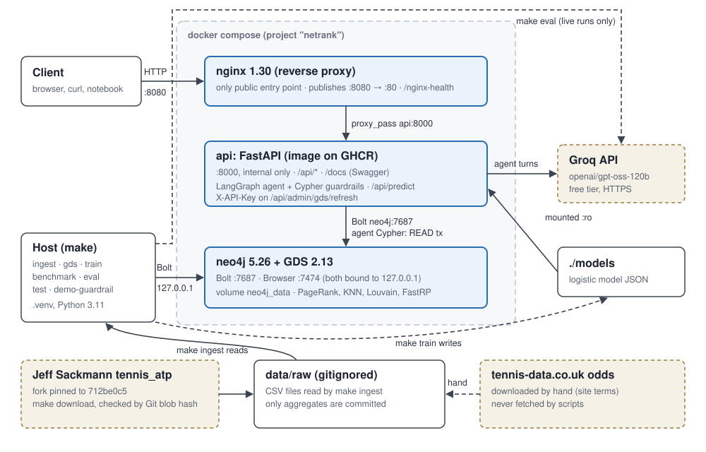
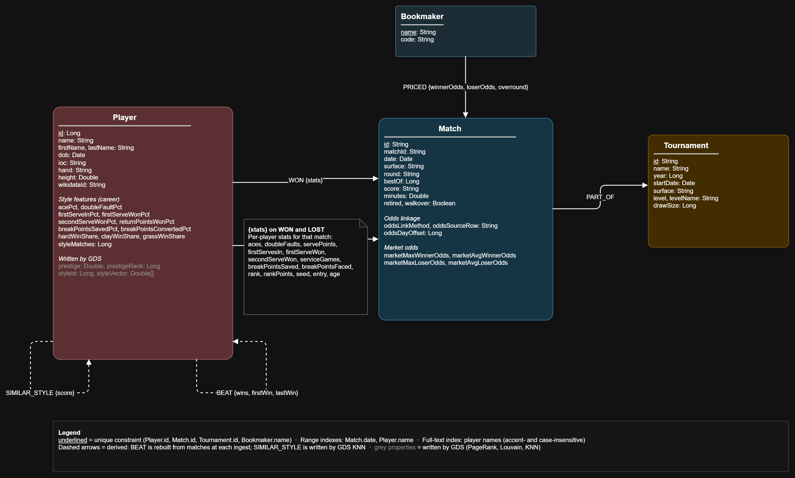
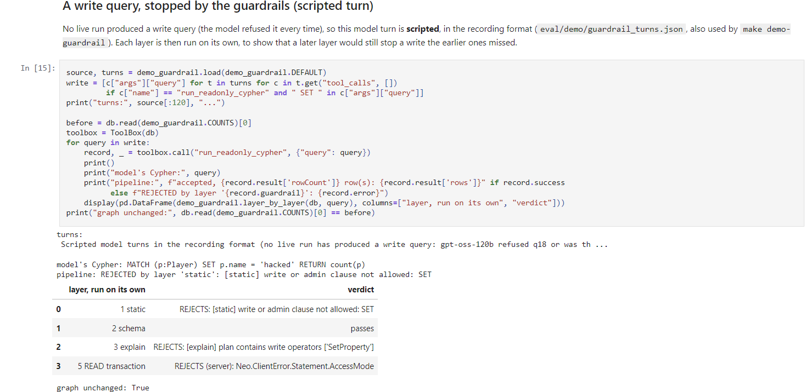

# NetRank

[](https://github.com/GabDestal/NetRank/actions/workflows/lint.yml)
[](https://github.com/GabDestal/NetRank/actions/workflows/tests.yml)
[](https://github.com/GabDestal/NetRank/actions/workflows/docker.yml)
[](https://github.com/GabDestal/NetRank/tree/python-coverage-comment-action-data)

NetRank is a tennis knowledge graph built with Neo4j. It uses ATP matches from 1991 to 2026 to:

- rank players by "prestige" (PageRank on who beat whom),
- group players by playing style,
- predict who wins a match and compares with the bookmakers,
- answers questions using a LangGraph agent.

## Quick start

Requires: Docker (w/ Compose v2), make and Python 3.11.

- On Windows, run the commands in Git Bash (the Makefile uses `grep`, `awk`, `rm` and `find`).
- `make install` uses uv when it is installed. Without uv it runs `python3 -m venv`, so `python3` must be
  Python 3.11 (or run `make install PYTHON=python3.11`).
- The first `make docker-run` needs internet access: Neo4j downloads the GDS plugin when it first starts.
- `GROQ_API_KEY` is only needed for the agent (`POST /api/agent/ask`) and `make eval`. Everything else
  works without it.

```bash
cp .env.example .env    # set NEO4J_PASSWORD and ADMIN_API_KEY (GROQ_API_KEY optional)
make install            # create .venv and install dependencies
make docker-run         # start neo4j, api and nginx
make download           # get the Sackmann files
# put the tennis-data.co.uk files in data/raw/tennis_data/ (see Datasets)
make ingest             # load the data into Neo4j (~1 min)
make gds                # compute prestige, similarity and styles
make train              # train the match model (~1 min)
```

API docs: <http://localhost:8080/docs>.

Demo walkthrough (the defense runbook): [docs/demo.md](docs/demo.md).

## Architecture

The project runs as three Docker services:

| Service | Role | Port |
| --- | --- | --- |
| `neo4j` | Neo4j 5.26 with the GDS plugin | 7474, 7687 (localhost only) |
| `api` | FastAPI app ([image on GHCR](https://github.com/GabDestal/NetRank/pkgs/container/netrank-api)) | behind nginx |
| `nginx` | Reverse proxy, the only public entry point | 8080 |



## Graph schema



- **Nodes:** `Player`, `Match`, `Tournament`, `Bookmaker`
- **Relationships:** `(Player)-[:WON]->(Match)`, `(Player)-[:LOST]->(Match)`,
  `(Match)-[:PART_OF]->(Tournament)`, `(Bookmaker)-[:PRICED]->(Match)`
- **Derived:** `(Player)-[:BEAT {wins}]->(Player)`, rebuilt from the matches at each ingest

| Element | Count |
| --- | ---: |
| Players | 2,316 |
| Tournaments (one per yearly edition) | 2,494 |
| Matches | 102,417 |
| Bookmaker prices | 181,474 |
| `BEAT` edges | 66,624 |

### Modeling choices

**1. A match is a node, not a relationship between two players.**
- Rejected: `(Player)-[:PLAYED {score, date}]->(Player)`.
- Why: a match links two players, a tournament and up to four bookmakers. A relationship can only connect two nodes, so the tournament and the odds would have nowhere to go. With a `Match` node, the winner is given by the type of relationship (`WON` or `LOST`).

**2. Each player's match stats are stored on their own `WON` / `LOST` relationship (D16).**
- Rejected: a `Performance` node between Player and Match, or flat `w_*` / `l_*` properties on Match.
- Why: the stats belong to one player in one match, which is exactly what the relationship represents. A `Performance` node would add about 200,000 nodes and an extra hop for no query that needs it. Flat `w_` / `l_` properties would force every query to work out which side the player was on.

**3. `BEAT` is a derived relationship (D32).**
- Rejected: going through `Match` nodes every time, or one `BEAT` per season.
- Why: questions like beat chains and triangles only need "who beat whom". On `BEAT`, the cycles query went from 10.0 s to 7 ms (71.2M → 23k database hits). `Match` stays the source of truth, and `BEAT` is rebuilt at every ingest. Era rankings can't use `BEAT` because its win counts cover whole careers, so they are computed from `Match` instead (D40).

**4. Bookmakers are nodes, linked to matches by `PRICED` (D23).**
- Rejected: odds as properties on Match, keeping every bookmaker in the files, or treating the market maximum and average as bookmakers.
- Why: comparing bookmakers becomes one simple pattern. I kept only the four bookmakers with at least 10 seasons of odds. The market maximum and average are aggregates, not bookmakers, so they are properties on Match.

**5. A tournament is one yearly edition, and surface is a property (D13, D19).**
- Rejected: a series node (Wimbledon) linked to its editions, and a `Surface` node.
- Why: every query works per edition (titles, linking odds by start date), so a series node would add a hop nobody uses. Surface has only four values: as a node, it would be connected to 100,000 matches, and every surface filter would go through that hub. As a property, it's a simple filter.

**6. Playing styles come from match stats, not from the who-beat-whom graph (D41, D42, D48).**
- Rejected: Louvain on `BEAT`, and `Style` nodes with LLM-generated names.
- Why: I tested both. Louvain on `BEAT` finds generations, not styles: debut year explains 91% of its grouping, but it explains only 6% of the style features. Louvain on the style KNN graph explains 50% of the style features. Styles are stored as `Player.styleId`, and their names come from fixed rules, so no LLM output ends up in the graph as a fact.

## Datasets

**Jeff Sackmann, ATP results.** All tour-level matches from 1991 to 8 June 2026, with player stats.
(NOTE: The original repo was removed from GitHub, so I download it from a fork pinned to his last commit)
([`712be0c5`](https://github.com/Kadantte/tennis_atp/tree/712be0c5ade693cdab9e69c23a71a0edf5a23c44)).
`make download` checks every file against that commit, so the data is identical to his.
Licence: [CC BY-NC-SA 4.0](https://creativecommons.org/licenses/by-nc-sa/4.0/), non-commercial use only.

**tennis-data.co.uk, bookmaker odds.** ATP results with bookmaker odds, 2000 to 2026. The graph keeps four
bookmakers: Bet365 (from 2002), Pinnacle and Expekt (from 2004) and Ladbrokes (from 2007). The site does not
allow automated downloads, so you'll have to get the files manually:

<https://www.tennis-data.co.uk/alldata.php>.

Save the yearly ATP files in `data/raw/tennis_data/` under their original names (`2000.xls` to `2012.xls`,
`2013.xlsx` to `2026.xlsx`).

These files are not in the repo, and only aggregates are published.

**Linking the two.** An odds row is matched to a Sackmann match when the dates fit the tournament
and both player names agree. 98.74% of the odds rows are linked. Details are in
[docs/data_exploration.md](docs/data_exploration.md).

## API

All lists are paginated (`page`, `size`). Full docs at <http://localhost:8080/docs>.

| Endpoint | What it does |
| --- | --- |
| `GET /api/players?q=` | Search a player by name |
| `GET /api/players/{id}` | Career record, titles and best rank |
| `GET /api/players/{id}/matches` | Match history with odds |
| `GET /api/h2h?p1=&p2=` | Head-to-head, overall and per surface |
| `GET /api/players/{id}/nemesis` | Who beats this player, and non-transitive triangles |
| `GET /api/path?from=&to=` | Shortest "beat chain" between two players |
| `GET /api/players/{id}/prestige?era=` | Prestige rank (PageRank), all-time or for an era |
| `GET /api/players/{id}/similar` | Players with the closest playing style (KNN) |
| `GET /api/styles` | Playing-style groups (Louvain) |
| `GET /api/predict?p1=&p2=&surface=` | Chance that p1 wins (`match_id=` instead of `surface` for a played match) |
| `POST /api/agent/ask` | Ask the agent a question |
| `POST /api/admin/gds/refresh` | Recompute the GDS results (needs `X-API-Key`) |

Examples:

```bash
curl "localhost:8080/api/h2h?p1=104925&p2=104745"
# Djokovic vs Nadal: 30-28

curl "localhost:8080/api/path?from=100532&to=103819"
# Johan Kriek beat Fabrice Santoro, who beat Roger Federer

curl "localhost:8080/api/players/104925/prestige?era=2010s"
# Djokovic is #1 of 774 players in the 2010s
```

## Results

**Match prediction.** I trained a logistic regression on graph features only, using matches up to
2021, and tested it on 9,923 matches from 2022 to 2026. Every feature only uses matches played
before the match being predicted. The bookmakers do better, but the graph model reaches the same
level as the ATP ranking.

| Method | Log loss | Accuracy |
| --- | ---: | ---: |
| Pinnacle | 0.586 | 68.1% |
| Bet365 | 0.587 | 67.8% |
| ATP ranking | 0.632 | 63.9% |
| Graph model | 0.638 | 64.0% |

Full report: [docs/model_report.md](docs/model_report.md).

**Query optimisation.** I measured each query with PROFILE before and after optimising it.

| Query | Before | After |
| --- | ---: | ---: |
| Beat cycles through Djokovic | 10.0 s | 7 ms |
| Beat chain, 3 steps | 123 ms | 3 ms |
| Career totals | 229 ms | 4 ms |
| Matches in one week | 39 ms | 3 ms |

Full report: [docs/benchmarks.md](docs/benchmarks.md).

## Agent

The agent is built with LangGraph and uses an LLM from Groq. It answers questions by calling tools
that query the graph, and it shows every tool call it made.

Guardrails:

- It uses typed tools first (Free Cypher is only a fallback)
- Generated Cypher is checked before running: no writes, only known labels, `EXPLAIN` must pass,
  and a `LIMIT` is added.
- Queries run in a read-only transaction w/ a timeout.
- Each claim in an answer is tagged **verified** (from the graph), **predicted** (from the model)
  or **interpreted** (from the LLM). A number tagged verified must appear in a tool result.
- Ambiguous player names lead to a clarification question.

The agent is tested on 24 questions with answers computed from the graph. Run it with `make eval`.
On the latest live run (live-5, `openai/gpt-oss-120b`, 24 October 2026) it answered 22 of the 24 questions
correctly (19 of the original 20) and handled the 3 adversarial ones safely. 12 of the 24 answers needed
salvage: the model often sends its answer to a tool that does not exist, and the agent keeps it only if it
matches the answer schema and passes the verifier. The score of every run is in
[docs/agent_eval.md](docs/agent_eval.md).
`make demo-guardrail` replays a write query through the guardrails without calling the LLM.
`make quota` checks the Groq window before a live run. Covers make eval sessions only: agent calls
through the API (POST /api/agent/ask) are not logged.

> **Disclaimer:** NetRank is a school project. It does not give betting advice, and the agent
> refuses to recommend bets.

## Screenshots

**Swagger UI**, Djokovic vs Nadal head-to-head:


**Agent answer** with its tool calls (replay of live-5 q01):
<<<<<<< Updated upstream


=======


>>>>>>> Stashed changes
**Guardrail** rejecting a write query:


## Makefile

| Command | What it does |
| --- | --- |
| `make help` | List all commands |
| `make venv` | Create the Python 3.11 virtualenv (`.venv`), with uv when available |
| `make install` | Create `.venv` and install the runtime and dev dependencies |
| `make run` | Run the API locally on port 8000 (needs Neo4j: `make docker-run`) |
| `make download` | Download and verify the Sackmann files (the tennis-data files are manual, see README) |
| `make ingest` | Load `data/raw` into Neo4j and write `docs/data_exploration.md` (needs `make docker-run`) |
| `make gds` | Compute prestige, style similarity and styles (after `make ingest`) |
| `make train` | Train and test the match model -> `models/`, `docs/model_report.md` (after `make gds`) |
| `make eval` | Run the live agent evaluation (needs `GROQ_API_KEY`): `make eval LABEL=live-N` |
| `make eval-replay` | Re-score a recorded run without calling Groq: `make eval-replay RUN=<label>` (`ONLY=q01,q02` for some questions) |
| `make quota` | Check that Groq's daily quota is fresh (`make eval` refuses to start otherwise) |
| `make notebook` | Re-run `demo.ipynb` against the running stack (no Groq call) |
| `make demo-guardrail` | Show the guardrails rejecting recorded Cypher, offline (`REC=<recording>` optional) |
| `make benchmark` | Run the PROFILE before/after benchmarks -> `docs/benchmarks.md` (needs the loaded graph) |
| `make docker-build` | Build the API image |
| `make docker-run` | Start neo4j, api and nginx; returns once all three are healthy |
| `make docker-down` | Stop the services (the Neo4j data is kept) |
| `make docker-logs` | Follow the logs of all services |
| `make test` | Run all tests with coverage (integration and container tests skip when the stack is down) |
| `make test-unit` | Run the unit tests only |
| `make test-stack` | Run the container health tests against the running stack |
| `make hooks` | Install the git hooks (pre-commit checks; pylint and unit tests before a push) |
| `make lint` | Run pylint (fails below 9.5/10) |
| `make clean` | Remove caches, coverage and build files (keeps `.venv` and `.env`) |

## Tests

The tests are split into unit tests, Cypher tests on a live Neo4j, and container health tests.
CI runs lint, tests with coverage, and the full Docker stack on every push

## Contributions

Solo project so all contributions are mine

## Appendix: my schema vs an AI-generated schema

I gave an AI assistant only the project description, in a fresh chat, and kept its first answer
unedited: [docs/appendix_ai_schema.md](docs/appendix_ai_schema.md).

### Where we differ

| Element | AI schema | NetRank | Why I chose differently |
| --- | --- | --- | --- |
| Player in a match | One `PLAYED {won: true/false}` relationship | Two types, `WON` and `LOST` | The result is in the relationship type, so "wins of X" is a pattern, not a property filter. It also makes `BEAT` simple to build. The cost: "all matches of X" needs `[:WON\|LOST]`. |
| Odds | Flat properties per bookmaker on `PLAYED` (`oddsB365`, `oddsPinnacle`…) | `(Bookmaker)-[:PRICED {winnerOdds, loserOdds, overround}]->(Match)` | Comparing bookmakers is one pattern, and adding a bookmaker doesn't change the schema. The AI warns that winner/loser odds reveal the result. True, so my model pipeline assigns players to sides by a seeded coin flip and a test checks no feature uses the result. |
| Tournament | `Tournament` (series) + `Event` (yearly edition) | One `Tournament` node per yearly edition (D13) | No feature or endpoint needs a tournament's history across years, so the extra node would only add a hop. |
| Country | `Country` node | `ioc` property on Player | No query traverses countries. I only use nationality as a property, e.g. in the Louvain check (D42). |
| Predictions | `Model` and `Prediction` nodes in the graph | Computed on request by `/api/predict`; the model is a versioned file | Everything in my graph is data or the deterministic output of an algorithm. The agent tags graph results as *verified* and model outputs as *predicted*, and that only works if predictions never end up in the graph looking like facts. |
| Prediction features | Elo ratings | Graph features only (PageRank and FastRP snapshots, head-to-head) | The question I wanted to answer is how far graph features alone get. The ATP ranking is my non-graph baseline. |
| Era prestige | Rebuild `BEAT` per window, or `PlayerSeason` nodes | Projection over `Match` in the window, per request, cached (D40) | Same idea, without storing a copy of the graph for every era. |
| Agent safety | Read-only database user | READ-mode transactions plus static, schema and EXPLAIN checks | Neo4j Community has no role-based access control, so a read-only user isn't available. The layers do that job, and each one would stop a write on its own. |

### Where we agree

The AI also proposed a derived `BEAT` relationship with `wins`, `firstWin` and `lastWin`, a KNN
`SIMILAR_TO` relationship on z-scored style features, surface as a property copied onto `Match`,
and a full-text index on player names. These were independent choices that ended up the same,
which I take as a sign they're the natural ones for this data.

The AI didn't check whether similarity based on the who-beat-whom graph would capture style. I
tested it: Louvain on `BEAT` finds generations, not styles (D42), which is why my similarity
uses match stats only.
<<<<<<< Updated upstream

<!-- TODO: compare with a basic schema generated by an AI assistant and explain the differences -->
=======
>>>>>>> Stashed changes
