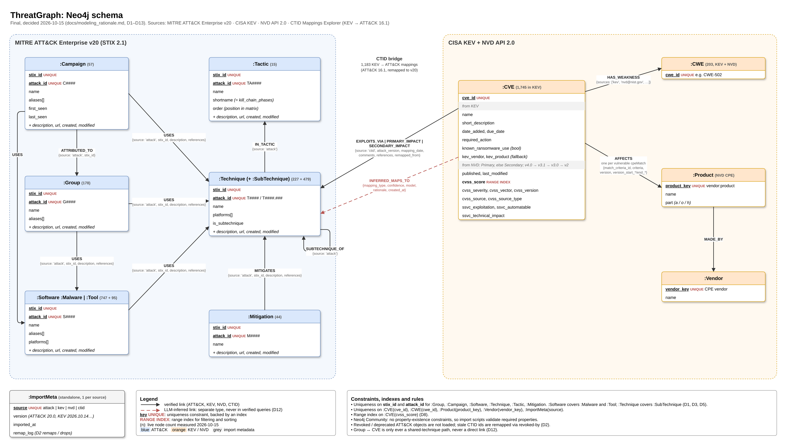
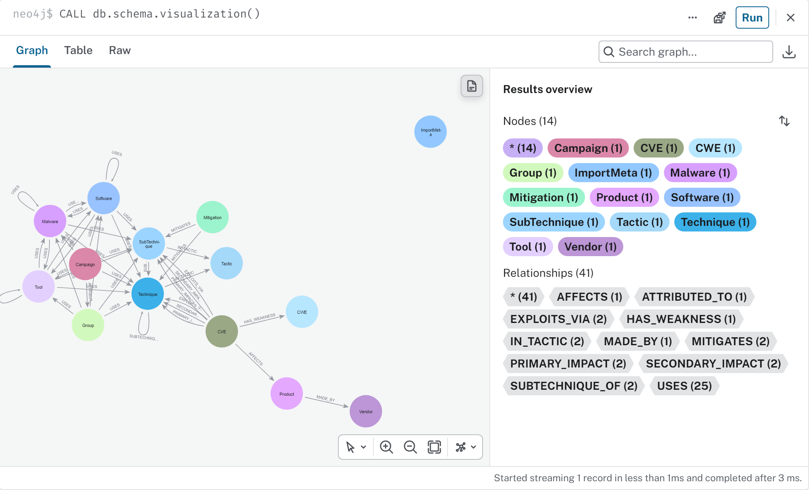
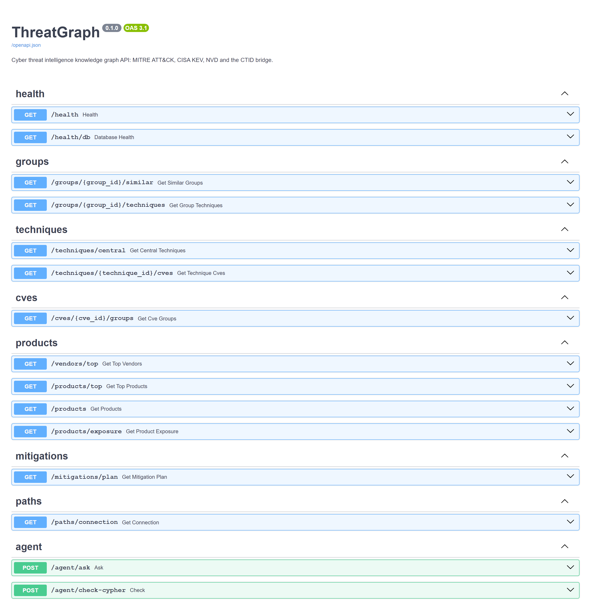
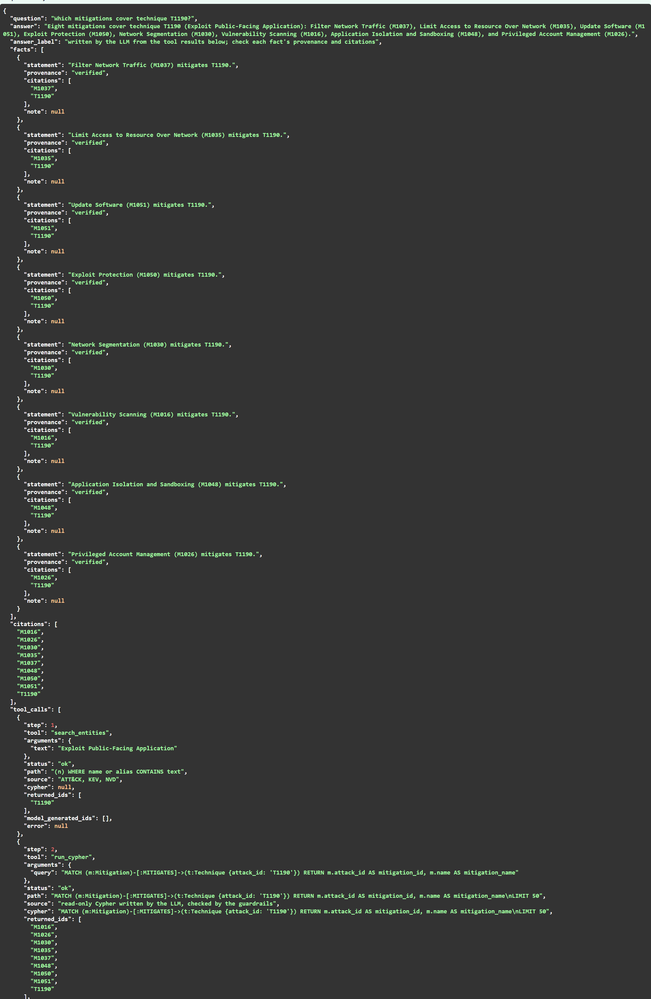

# threatgraph

[](https://github.com/GabDestal/threatgraph/actions/workflows/lint.yml)
[](https://github.com/GabDestal/threatgraph/actions/workflows/test.yml)

A knowledge graph for cyber threat intelligence (CTI), in Neo4j. It links MITRE ATT&CK (groups,
techniques, tactics, mitigations, software) with the CISA Known Exploited Vulnerabilities catalog,
NVD details for those CVEs (CVSS, CWE, affected products) and CTID's mappings from CVEs to ATT&CK
techniques. A FastAPI service answers seven questions over it, such as "what is my exposure if I run
FortiOS?" or "which mitigations cover the most exploited techniques?". A LangGraph agent answers the
same questions in plain English, with citations.

A walkthrough of everything with real outputs: [`demo.ipynb`](demo.ipynb).



Schema and design decisions (D1–D19) and rejected alternatives: [`docs/modeling_rationale.md`](docs/modeling_rationale.md).
Comparison with a generic AI-generated schema: [`docs/anti_genericity_appendix.md`](docs/anti_genericity_appendix.md).
Diagram source: [`docs/schema.drawio`](docs/schema.drawio).

## Architecture

```
 data sources (HTTPS)                      Docker Compose stack
 ATT&CK STIX, KEV, NVD API, CTID
        |  make download                    browser / curl / notebook
        v                                          | :8080
   data/raw/  (+ manifest.json)             +------v------+
        |  make ingest / analytics / predict |    nginx    |  reverse proxy
        |  (Bolt :7687)                      +------+------+
        v                                           | :8000 (internal)
 +--------------------+     Bolt :7687      +------v------+     HTTPS     +-----------------+
 |  Neo4j 5.26        |<--------------------|  api        |-------------->| LLM: Groq       |
 |  + APOC + GDS      |   read-only queries |  FastAPI +  |               | (or Ollama on   |
 |  browser :7474     |                     |  agent      |               |  the host:11434)|
 +--------------------+                     +-------------+               +-----------------+
```

| Service | Image | Port | Role |
|---------|-------|------|------|
| `neo4j` | `neo4j:5.26-community` + APOC, GDS | 7474 (browser), 7687 (Bolt) | The graph; memory capped at 1 GB heap, 512 MB page cache |
| `api` | built from `Dockerfile` (python:3.12-slim) | 8000, internal only | FastAPI endpoints and the agent |
| `nginx` | `nginx:1.27-alpine` | 8080 | Public entry point, proxies to the api |
| `ollama` (optional) | `ollama/ollama:0.34.4` | 11434 | Local LLM; only with `--profile ollama` |

The download and ingest scripts run on the host and write to Neo4j over Bolt. The api only reads.
Every service has a Docker healthcheck, and each one starts only after the service before it is healthy.

Architecture diagram source: [`docs/architecture.drawio`](docs/architecture.drawio).

### Docker image

The api image is on Docker Hub: [`gabdestal/threatgraph-api`](https://hub.docker.com/r/gabdestal/threatgraph-api).
It is the same image `make docker-run` builds from the `Dockerfile` (code in `app/` only, no `.env`).

```bash
docker pull gabdestal/threatgraph-api:1.0
```

## Screenshots

Images are in [`docs/screenshots/`](docs/screenshots/).

| Neo4j Browser | Swagger UI (`/docs`) | Agent answer |
|---|---|---|
|  |  |  |

## Layout

```
app/            FastAPI app: routers, services (Cypher), models (Pydantic), database, agent
scripts/        Download, ingestion, analytics, link prediction, agent evaluation and demo
tests/          pytest suite (unit tests with a fake driver, integration tests against Neo4j)
nginx/          Reverse proxy config for the Docker stack
docs/           Diagrams (draw.io), screenshots, modeling rationale (D1–D19), anti-genericity appendix, link prediction, benchmarks, audit
demo.ipynb      Walkthrough notebook, committed with outputs
.env.example    Template for local settings
```

## Getting started

Requires Python 3.12.

```bash
python -m venv .venv
source .venv/bin/activate        # Windows: .venv\Scripts\activate
make install
cp .env.example .env
```

## Data

```bash
make download           # fetch every source into data/raw/ (skips files already there)
make download FORCE=1   # re-download everything
python -m scripts.download --only kev nvd   # selected sources
```

| Source | Version | File |
|--------|---------|------|
| MITRE ATT&CK Enterprise (STIX 2.1) | 20.0, pinned | `data/raw/attack/enterprise-attack-20.0.json` |
| CISA KEV catalog | latest (version recorded) | `data/raw/kev/known_exploited_vulnerabilities.json` |
| CTID Mappings Explorer, KEV → ATT&CK | 16.1, file `kev-07.28.2025` | `data/raw/ctid/kev-07.28.2025_attack-16.1-enterprise.json` |
| NVD API 2.0, every CVE in KEV | retrieval date | `data/raw/nvd/nvd_kev_cves.json` |

NVD records come from the API's `hasKev` filter (4 paged requests); any KEV CVE it misses is fetched
individually. Set `NVD_API_KEY` in `.env` to raise the rate limit
([request a key](https://nvd.nist.gov/developers/request-an-api-key)).
Each download is validated (expected version, expected structure) before it is kept, and recorded in
`data/raw/manifest.json` with its URL, version, SHA-256, size and download time.

## Running

```bash
make run          # API only, on http://localhost:8000 (auto-reload)
make docker-run   # neo4j + api + nginx
make docker-down  # stop the stack, keep the Neo4j volume
```

Once Neo4j is up, create the constraints and indexes (safe to re-run):

```bash
make schema
```

Then load the downloaded data (creates the schema first; re-runs update in place):

```bash
make ingest     # ATT&CK, KEV + NVD, CTID, then make analytics; every count is verified after loading
make analytics  # GDS: technique degree, betweenness and Louvain communities, stored as properties
make predict    # link prediction CVE → technique; stores suggestions only if it beats the baseline
```

`make predict` currently stores nothing: on a CVE-disjoint, date-based split the model does not beat
"suggest the most common techniques". See [`docs/link_prediction.md`](docs/link_prediction.md).

| Source | Loads | Counts (2026-10-15) |
|--------|-------|---------------------|
| ATT&CK v20 | groups, campaigns, software, techniques, tactics, mitigations and their relationships | 1,842 nodes, 21,838 relationships |
| KEV + NVD | CVEs, CWEs, products, vendors; `HAS_WEAKNESS`, `AFFECTS`, `MADE_BY` | 1,745 CVEs, 203 CWEs, 3,599 products, 393 vendors; 37,040 relationships |
| CTID (ATT&CK 16.1) | CVE → technique bridge: `EXPLOITS_VIA`, `PRIMARY_IMPACT`, `SECONDARY_IMPACT` | 1,183 relationships covering 419 CVEs; 6 remapped to v20 successors |

The Docker stack needs `.env` with `NEO4J_PASSWORD` set (letters and digits only). The first start downloads the APOC and GDS plugins, which can take a few minutes.

| Service | URL | Notes |
|---------|-----|-------|
| nginx → api | http://localhost:8080 | `GET /health` → `{"status": "ok"}`; `GET /health/db` → Neo4j version, or 503 if unreachable |
| Neo4j Browser | http://localhost:7474 | user `neo4j`, password from `.env` |
| Neo4j Bolt | bolt://localhost:7687 | |

## API

Interactive documentation: http://localhost:8080/docs. Every endpoint is read-only and uses
parameterized Cypher.

| Question | Endpoint | Example |
|----------|----------|---------|
| 1. Techniques of a group, their tactics and mitigations | `GET /groups/{group_id}/techniques` | `/groups/G0016/techniques` |
| 2. KEV CVEs exploited via a technique (ransomware filter) | `GET /techniques/{technique_id}/cves` | `/techniques/T1190/cves?ransomware=true` |
| 3. Groups sharing a technique with a CVE (association only) | `GET /cves/{cve_id}/groups` | `/cves/CVE-2021-44228/groups?limit=10` |
| 4. Most exploited vendors / products, by weakness | `GET /vendors/top`, `GET /products/top` | `/vendors/top?limit=10&cwe_limit=3` |
| 5. Mitigation plan: greedy weighted cover, with the uncoverable techniques listed | `GET /mitigations/plan` | `/mitigations/plan?since=2025-01-01&max_picks=5` |
| 6. Central techniques: most used, connectors (betweenness), communities | `GET /techniques/central` | `/techniques/central?by=betweenness` |
| 7. A product's full exposure | `GET /products/exposure` | `/products/exposure?product=fortinet:fortios` |
| Groups with similar technique profiles (GDS node similarity, live) | `GET /groups/{group_id}/similar` | `/groups/G0016/similar?limit=5` |
| How is a group connected to a product? (bounded shortest path) | `GET /paths/connection` | `/paths/connection?group=G0016&product=fortinet:fortios&max_hops=6` |
| (helper) Find a product key | `GET /products` | `/products?search=fortios` |

Graph algorithms: `/groups/{id}/similar` runs GDS node similarity (Jaccard) on request, on a
projection created and dropped per call (D17). `/techniques/central` serves degree, betweenness and
Louvain results computed by GDS in `make analytics` (D15, D16). `/mitigations/plan` is a greedy
weighted maximum-coverage optimization (D14). `/paths/connection` runs a bounded Cypher
`shortestPath` over verified links only (D20):

```bash
curl "http://localhost:8080/paths/connection?group=G0016&product=fortinet:fortios"
```

```json
{
  "hops": 3,
  "nodes": [{"kind": "Group", "id": "G0016", "name": "APT29"},
            {"kind": "Technique", "id": "T1190", "name": "Exploit Public-Facing Application"},
            {"kind": "CVE", "id": "CVE-2022-42475", "name": "Fortinet FortiOS Heap-Based Buffer Overflow Vulnerability"},
            {"kind": "Product", "id": "fortinet:fortios", "name": "fortios"}],
  "relationships": [{"type": "USES", "direction": "forward"},
                    {"type": "EXPLOITS_VIA", "direction": "backward"},
                    {"type": "AFFECTS", "direction": "forward"}],
  "reading": "APT29 (G0016) shares technique Exploit Public-Facing Application (T1190) with Fortinet FortiOS Heap-Based Buffer Overflow Vulnerability (CVE-2022-42475) affecting fortios (fortinet:fortios). Path: ...",
  "note": "The group and the product are linked through a shared technique (CTID mapping). This is an association, not evidence that the group exploited this product."
}
```

`404` when the group or product is unknown, or no path fits within `max_hops` (the message gives
the shortest length found).

Errors: `404` for an unknown id, `422` for a malformed one (e.g. `G0016`, `T1059.001` and
`CVE-2021-44228` formats are enforced), `503` when Neo4j is unavailable. Answers that link groups
to vulnerabilities say so explicitly (`"association": "shared_technique"` plus a note): they are
never evidence of exploitation (D12).

## Agent

`POST /agent/ask` answers a question in plain English using the graph (D19). A LangGraph loop lets the
LLM call tools: the same functions as the endpoints above, plus `run_cypher` as a guarded fallback for
questions no tool covers. Every answer comes back with the tool calls it made, the graph paths it
walked, and a list of facts. The server, not the LLM, marks each fact `verified` (all its citations
were returned by a tool from ATT&CK, KEV, NVD or CTID) or `model-generated` (it cites a link
prediction, an id no tool returned, or nothing).

```bash
curl -X POST localhost:8080/agent/ask -H "Content-Type: application/json" \
     -d '{"question": "Which initial access techniques does Cozy Bear use?"}'
```

Generated Cypher only runs if it passes the guardrails: one read-only statement (no `CREATE`, `MERGE`,
`DELETE`, `SET`, `REMOVE`, `DROP`, `CALL`, `LOAD CSV`...), a `LIMIT` of at most 50 (added or lowered),
and an `EXPLAIN` showing a read-only plan with no unknown labels, relationship types or properties.
It then runs in a read transaction with a 10 s timeout. A rejected query is sent back to the LLM with
the reason, at most twice. `POST /agent/check-cypher` runs a query through the guardrails without executing it.

```bash
make guardrail-demo   # scripted bad LLM output rejected by the guardrails, against the real graph (no LLM needed)
make evaluate-agent   # 15 questions (7 core, fallback Cypher, prompt injection); writes data/processed/agent_eval_*.json
```

On Groq with `qwen/qwen3.8-27b`, 13 of the 15 questions pass (2026-10-16). Both prompt injections were
refused, and the graph was unchanged after every question. The two failures and their details are in
D19 of [`docs/modeling_rationale.md`](docs/modeling_rationale.md).

### Choosing the LLM

Set `LLM_PROVIDER` in `.env`. Nothing here needs a paid API.

| Provider | Setting | Default model | Notes |
|----------|---------|---------------|-------|
| Groq (default) | `GROQ_API_KEY` ([free key](https://console.groq.com/keys)) | `qwen/qwen3.8-27b` | Free tier: 8,000 tokens/min, 1,000 requests/day |
| Ollama, local | nothing | `qwen2.5:3b` | No key, runs on the CPU; slower and less accurate |
| Anthropic | `ANTHROPIC_API_KEY` | `claude-haiku-5-5` | Paid |

`LLM_MODEL` overrides the default model. On Groq, `openai/gpt-oss-120b` is bigger, but in our tests
it often came back with an empty reply or a malformed tool call, so `qwen/qwen3.8-27b` is the default.

Free tiers answer HTTP 429 when the per-minute budget is used up. Every LLM call then waits and retries
(2, 4, 8... s, up to 60 s, or longer if the server says so; `LLM_MAX_RETRIES`, default 6).
`make evaluate-agent` also waits `DELAY` seconds between questions (default 30). If a run still hits
the limit, raise it: `make evaluate-agent DELAY=60`.

**Running without a key (recommended local setup): native Ollama.** Install it from
[ollama.com/download](https://ollama.com/download) (Windows: `winget install Ollama.Ollama`), then:

```bash
ollama pull qwen2.5:3b       # about 2 GB
# in .env: LLM_PROVIDER=ollama
make run                     # the API reaches Ollama on http://localhost:11434
```

In the Docker stack, the api container reaches the native Ollama through `host.docker.internal`.
Running Ollama natively, rather than in Docker, keeps it outside Docker Desktop's memory limit.
`make ollama-docker` starts the optional `ollama` compose service instead; then set
`DOCKER_OLLAMA_BASE_URL=http://ollama:11434` in `.env`. A 3B model takes about a minute per question
on a laptop CPU. It also often answers in plain text instead of the structured answer, and then the
answer has citations but no fact list.

Neo4j's memory is capped in `docker-compose.yml` (heap 512 MB to 1 GB, page cache 512 MB), so it fits
next to a local model on a 16 GB machine. The whole graph fits in that page cache.

## Makefile

| Target | What it does |
|--------|--------------|
| `make help` | List the targets |
| `make install` | Install the pinned dependencies |
| `make download` | Fetch every source into `data/raw/` (`FORCE=1` to refresh) |
| `make schema` | Create constraints and indexes |
| `make ingest` | Schema, then ATT&CK, KEV + NVD, CTID, then `make analytics` |
| `make analytics` | GDS degree, betweenness and Louvain, stored as properties |
| `make predict` | Link prediction evaluation; stores suggestions only if it beats the baseline |
| `make run` | API on the host with auto-reload (port 8000) |
| `make docker-run` / `make docker-down` | Start or stop neo4j, api and nginx |
| `make evaluate-agent` | Agent evaluation, 15 questions (`DELAY=30`) |
| `make guardrail-demo` | Guardrails rejecting scripted bad LLM output |
| `make ollama-docker` | Optional Ollama container with the local model |
| `make lint` | pylint, fails under 9.5 |
| `make test` | All tests with coverage, fails under 80%; the Neo4j tests skip, with the reason, if the database is down |
| `make test-integration` | Only the end-to-end tests against the loaded Neo4j |
| `make benchmark` | PROFILE three queries with and without their index or rewrite ([`docs/benchmarks.md`](docs/benchmarks.md)) |
| `make coverage` | HTML coverage report |
| `make clean` | Remove caches and coverage output |

On Windows, `make` comes from scoop (`scoop install make`) or Git for Windows' SDK.

## Development

```bash
make lint              # pylint (fails under 9.5/10)
make test              # pytest + coverage (fails under 80%), Neo4j tests included when the database is up
make coverage          # HTML report in htmlcov/
make test-integration  # only the end-to-end tests against the loaded Neo4j (make docker-run, make ingest first)
make benchmark         # PROFILE before/after, results in docs/benchmarks.md
```

`tests/test_integration.py` runs real Cypher through the API. It checks first whether Neo4j is
reachable and loaded; if not (as in CI) its 13 tests are skipped and pytest prints why.

CI runs the same checks on every push to `main` and on every pull request:

- `lint.yml`: pylint, minimum score 9.5
- `test.yml`: pytest with coverage

## Contributing

`main` is protected, so every change lands through a pull request that passes both checks.

Commit messages use a type prefix:

- `feat:` new functionality
- `fix:` bug fixes
- `test:` tests only
- `docs:` documentation only
- `refactor:` code changes with no behavior change
- `chore:` tooling, dependencies, housekeeping
