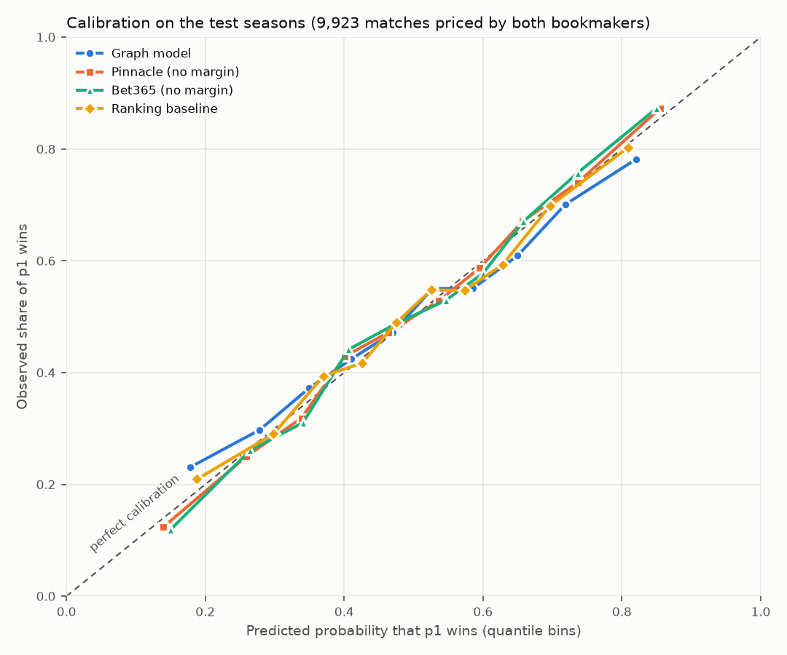

# Match-outcome model report

Generated by `make train` (`scripts/train.py`). Model `logistic-20261022-e0b4aae3`.

## Data and split

One row per played match (walkovers excluded) from 1995; p1/p2 assigned by a seeded coin flip per match; label = p1 won. Features are p1 - p2 differences computed only from matches before the match (graph snapshot at Jan 1 of its season; history strictly before its date).

| Split | Rows | p1 won rate | First match | Last match |
| --- | ---: | ---: | --- | --- |
| test | 12,152 | 0.4986 | 2022-01-03 | 2026-05-25 |
| train | 69,275 | 0.5010 | 1995-01-02 | 2018-12-31 |
| valid | 6,460 | 0.4981 | 2019-01-07 | 2021-11-15 |

## Model selection (validation 2019-2021 only)

| Candidate | Log loss | Brier | Accuracy | Rows |
| --- | ---: | ---: | ---: | ---: |
| logistic C=0.001 | 0.646 | 0.2269 | 0.6224 | 6460 |
| logistic C=0.01 | 0.6419 | 0.2252 | 0.6271 | 6460 |
| logistic C=0.1 | 0.6413 | 0.225 | 0.6285 | 6460 |
| logistic C=1.0 | 0.6413 | 0.225 | 0.6285 | 6460 |
| logistic C=10.0 | 0.6413 | 0.225 | 0.6289 | 6460 |
| gradient_boosting | 0.6443 | 0.2266 | 0.6245 | 6460 |
| ranking baseline (reference only) | 0.6344 | 0.2228 | 0.6245 | 6460 |

Chosen: **logistic** with C = 0.1. Gradient boosting is kept only if it improves validation log loss by at least 1%. The chosen model is refitted on train + validation before the test.

## Test (2022-2026, evaluated once)

Same rows for every predictor: completed matches (no walkover, no retirement) priced by both Pinnacle and Bet365. Bookmaker probabilities have the margin removed: (1/o1) / (1/o1 + 1/o2). The ranking baseline is a one-feature logistic model on log(rank p2 / rank p1), fitted on train.

| Predictor | Log loss | Brier | Accuracy | Rows |
| --- | ---: | ---: | ---: | ---: |
| Graph model | 0.6377 | 0.2232 | 0.6396 | 9923 |
| Pinnacle (no margin) | 0.586 | 0.2015 | 0.6805 | 9923 |
| Bet365 (no margin) | 0.5866 | 0.2017 | 0.6784 | 9923 |
| Ranking baseline | 0.6318 | 0.2209 | 0.6392 | 9923 |

Retired matches (same predictors, reported separately):

| Predictor | Log loss | Brier | Accuracy | Rows |
| --- | ---: | ---: | ---: | ---: |
| Graph model | 0.7257 | 0.2621 | 0.5458 | 306 |
| Pinnacle (no margin) | 0.7084 | 0.2541 | 0.5556 | 306 |
| Bet365 (no margin) | 0.704 | 0.2523 | 0.5654 | 306 |
| Ranking baseline | 0.7014 | 0.2525 | 0.5752 | 306 |

Graph model on every completed test match (with or without odds): log loss 0.6334, accuracy 0.6428 (11,792 rows).

## Calibration (test, common rows)

| Predictor | Predicted (bin mean) -> observed |
| --- | --- |
| Graph model | 0.18->0.23, 0.28->0.30, 0.35->0.37, 0.41->0.42, 0.47->0.47, 0.53->0.55, 0.59->0.55, 0.65->0.61, 0.72->0.70, 0.82->0.78 |
| Pinnacle (no margin) | 0.14->0.12, 0.26->0.25, 0.34->0.32, 0.40->0.43, 0.46->0.47, 0.54->0.53, 0.60->0.59, 0.66->0.67, 0.74->0.74, 0.86->0.87 |
| Bet365 (no margin) | 0.15->0.12, 0.26->0.26, 0.34->0.31, 0.41->0.44, 0.47->0.49, 0.55->0.53, 0.60->0.58, 0.66->0.67, 0.74->0.76, 0.85->0.87 |
| Ranking baseline | 0.19->0.21, 0.30->0.29, 0.37->0.39, 0.43->0.42, 0.48->0.49, 0.53->0.55, 0.57->0.55, 0.63->0.59, 0.70->0.70, 0.81->0.80 |

## What the model uses

| Feature (p1 - p2) | Weight per standard deviation |
| --- | ---: |
| logRecentPrestige | +0.618 |
| logPrestige | -0.549 |
| surfaceWinRate | +0.540 |
| logExperience | +0.249 |
| headToHead | +0.117 |
| unseen | -0.111 |
| inactiveRecently | -0.062 |
| headToHeadShare | +0.014 |
| fastrp00..63 (64 dims) | mean abs 0.018, max abs 0.082 |

- Log loss gap to Pinnacle: +0.0517; to the ranking baseline: +0.0059 (positive = worse).
- logPrestige and logRecentPrestige are correlated (r = 0.88 on train), so their weights are not interpretable one by one: together they reward recent prestige and penalise a career prestige that recent results no longer support.
- The ranking baseline uses ATP ranks, which summarise 52 weeks of results at every level (Challengers, qualifying) that are not in this graph; the graph model sees tour-level matches only.
