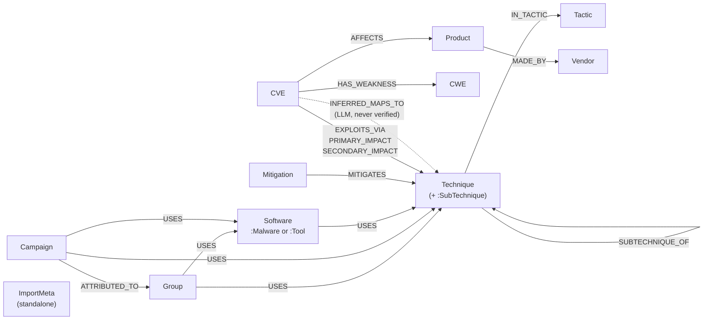

# Modeling rationale

This file records every graph-modeling decision for ThreatGraph: the options considered, their
trade-offs, the choice made and why, and the alternatives that were rejected. It is the reference
for the oral defense.

Each section ends with a **Decision** line giving the chosen option and its reason. Every option
not chosen is listed, with its reason, under [Rejected alternatives](#rejected-alternatives).

## Decision log

| ID  | Decision                                       | Choice | Status  | Date       |
|-----|------------------------------------------------|--------|---------|------------|
| D1  | Node identifiers and uniqueness                | C      | Decided | 2026-10-15 |
| D2  | ATT&CK version, revoked and deprecated objects | B      | Decided | 2026-10-15 |
| D3  | Techniques vs sub-techniques                   | B      | Decided | 2026-10-15 |
| D4  | Tactics                                        | A      | Decided | 2026-10-15 |
| D5  | Software: malware and tools                    | C      | Decided | 2026-10-15 |
| D6  | Scope: campaigns and detection content         | B      | Decided | 2026-10-15 |
| D7  | Properties on ATT&CK relationships             | A      | Decided | 2026-10-15 |
| D8  | CVE severity (CVSS, SSVC)                      | A + A1 | Decided | 2026-10-15 |
| D9  | Weaknesses (CWE)                               | A      | Decided | 2026-10-15 |
| D10 | Vendors and products (KEV, CPE)                | B      | Decided | 2026-10-15 |
| D11 | The CVE ↔ ATT&CK bridge                        | B      | Decided | 2026-10-15 |
| D12 | Verified vs LLM-inferred links                 | B      | Decided | 2026-10-15 |
| D13 | Ingestion write strategy                       | A      | Decided | 2026-10-15 |
| D14 | Question 5: ranking mitigations                | C      | Decided | 2026-10-15 |
| D15 | Question 6: technique centrality               | C      | Decided | 2026-10-15 |
| D16 | Where algorithm results live                   | B      | Decided | 2026-10-15 |
| D17 | Group similarity, computed live                | A      | Decided | 2026-10-15 |
| D18 | Link prediction                                | –      | Open    |            |

---

## 0. What the data actually looks like

Measured on 2026-10-15 from the live sources, so the trade-offs below rest on real numbers.

**MITRE ATT&CK Enterprise v20** (STIX 2.1 bundle, 55 MB), counting only objects that are neither
revoked nor deprecated:

| STIX type | ATT&CK concept | Live | Revoked/deprecated |
|---|---|---|---|
| `intrusion-set` | Group (G####) | 178 | 15 |
| `campaign` | Campaign (C####) | 57 | 0 |
| `malware` / `tool` | Software (S####) | 747 / 95 | 3 / 0 |
| `attack-pattern` | Technique (T####) | 227 | 143 |
| `attack-pattern` with `x_mitre_is_subtechnique` | Sub-technique (T####.###) | 479 | 18 |
| `x-mitre-tactic` | Tactic (TA####) | 15 | 0 |
| `course-of-action` | Mitigation (M####) | 44 | 224 |
| `x-mitre-detection-strategy` / `x-mitre-analytic` | Detection content | 703 / 1,770 | 2 / 0 |

The relationships between live objects:

| Count | Source → type → target |
|---|---|
| 10,739 | malware `uses` technique |
| 4,815 | group `uses` technique |
| 1,477 | mitigation `mitigates` technique |
| 1,213 | campaign `uses` technique |
| 869 | tool `uses` technique |
| 703 | detection-strategy `detects` technique |
| 691 / 475 | group `uses` malware / tool |
| 479 | sub-technique `subtechnique-of` technique |
| 92 / 81 | campaign `uses` malware / tool |
| 26 | campaign `attributed-to` group |

Other facts that matter:
- A technique's tactics are not STIX relationships. They are listed in each technique's
  `kill_chain_phases`, and 145 of 706 techniques and sub-techniques belong to more than one tactic.
- In v20, the old *Defense Evasion* tactic is gone, split into **Stealth** and
  **Defense Impairment**.
- Each `uses` relationship carries a procedure description, 197 characters on average.
- **No live ATT&CK object references a CVE.** ATT&CK alone never links a group to a CVE.

**CISA KEV** (catalog 2026.10.14):
- 1,745 CVEs, 361 of them with known ransomware use.
- 289 vendors and 734 vendor/product pairs.
- 1,570 CVEs list at least one CWE, 108 list several, and 189 distinct CWEs appear.
- Vendor names are free text, for example `7-Zip`, `ASUS`, `Adobe`.

**NVD API 2.0**, using Log4Shell (CVE-2021-44228) as a worst case:
- CVSS v3.1 comes from two sources (NVD, marked *Primary*, and a CNA, *Secondary*), plus CVSS v2
  and a CISA **SSVC** assessment (`exploitation: active`, `automatable: yes`,
  `technicalImpact: total`).
- The CWEs disagree by source: Apache lists CWE-20, CWE-400 and CWE-502; NVD lists CWE-917.
- **396 CPE match entries covering 166 distinct vendor:product pairs.** 102 of them are version
  ranges, and 23 are marked `vulnerable=false`, meaning they are platform context rather than an
  affected product.
- Without an API key, NVD allows 5 requests per 30 s, so one pass over all of KEV takes about
  3 hours. With a key it takes about 20 minutes.

**CTID Mappings Explorer, KEV → ATT&CK** (latest file `kev-07.28.2025`, built on ATT&CK **16.1**):
- 1,183 mappings of three types: `exploitation_technique` (460), `primary_impact` (407) and
  `secondary_impact` (316).
- **Only 419 CVEs are mapped, 24% of today's KEV.** The 1,326 CVEs added since, or never mapped,
  have no verified ATT&CK link.
- On average 2.8 mappings per mapped CVE, at most 14.
- 155 distinct technique IDs. In v20, 3 of them are revoked or deprecated (6 mappings), and
  techniques mapped under *Defense Evasion* now sit under the split tactics.

**Size.** A full graph is roughly 5–10k nodes and 25–30k relationships, which is small for Neo4j.
Apart from D10, the choices below are about how clear queries are and whether the answers can be
trusted, not about performance.

---

## 1. Questions the graph must answer

The schema exists to answer these questions, so every decision below is judged against them.
**Status: questions 1–7 confirmed on 2026-10-15.**

1. Which techniques does group *X* use, under which tactics, and which mitigations cover them?
2. Which KEV CVEs are used for exploitation technique *T*, and which of those have known
   ransomware use?
3. Which groups use the techniques that CVE *C* enables? This is an *indirect*, path-based
   association, not proof that the group exploited *C* (see D12).
4. Which vendors or products have the most actively exploited CVEs, broken down by weakness
   (CWE)?
5. Which mitigations would cover the most techniques reachable from currently exploited CVEs?
   This is a ranking and graph-algorithm question (GDS).
6. Which techniques are most central in the group–technique graph? This one also uses GDS:
   PageRank, betweenness, community detection.
7. I run product *P*. Which actively exploited CVEs affect it, which techniques do they enable,
   which groups use those techniques, and which mitigations cover the most of them?

---

## D1. Node identifiers and uniqueness

Every ATT&CK object has a STIX id (`intrusion-set--bef4c620-…`) and an ATT&CK id (`G0016`). The
STIX id is the stable key that STIX relationships point to. The ATT&CK id is what people, the
CTID mappings and the LLM agent use.

| Option | For | Against |
|---|---|---|
| **A. Key on the STIX id**, store the ATT&CK id as an indexed property | Stable across renames, and relationships join on it directly during import | Agent and API lookups go through a secondary index; ids are unreadable when debugging |
| **B. Key on the ATT&CK id**, keep the STIX id as a property | Readable; matches CTID and how users ask questions | An ATT&CK id can move to another object when one is revoked, so the import must resolve `revoked-by` first |
| **C. Both, each with a uniqueness constraint** | Index-backed lookups either way | Two constraints per label (cheap at this size) |

Non-ATT&CK nodes: CVE → `cve_id`, CWE → `cwe_id`, Product → see D10.

**Cost:** with a uniqueness constraint, a lookup is a B-tree index seek, O(log n); without one it
is a label scan, O(n).

**Decision (2026-10-15):** **C**. The STIX id is the import join key; the ATT&CK id is what users, CTID and the agent use. Both are index-backed.

## D2. ATT&CK version, revoked and deprecated objects

The CTID mappings use v16.1 and the current release is v20. 3 mapped technique ids are dead in
v20, and the tactics have been restructured.

| Option | For | Against |
|---|---|---|
| **A. Load v16.1** to match the mappings exactly | No mismatch at all | Two years out of date; loses current groups and techniques and the new tactic split |
| **B. Load v20 and remap old ids** through `revoked-by` relationships at import, logging what changed | Current data; every remap is explainable | Some mappings may have no clean successor and need a stated rule (drop or keep as stale) |
| **C. Load v20 and keep revoked/deprecated nodes** flagged `revoked: true`, linked with `REVOKED_BY` | Nothing is lost; old ids still resolve | Every query must filter `WHERE NOT n.revoked`, and forgetting to is an easy bug |

**Decision (2026-10-15):** **B**. Load ATT&CK v20 for current data, and remap the 6 stale CTID mappings through `revoked-by`, logging each remap. Mappings with no clean successor are dropped and listed in the import log. `attack_version` is stored in the import metadata.

**Outcome (CTID load, 2026-10-15):** the 3 stale technique ids were all *revoked* in v20 (none
deprecated), each with a live successor, so all 6 mappings were remapped and none dropped. Each
remapped relationship keeps the original id in `remapped_from`, and the list is stored in
`:ImportMeta {source: 'ctid'}.remap_log`.

| CVE | Mapping | CTID id (ATT&CK 16.1) | v20 successor |
|---|---|---|---|
| CVE-2025-31201, CVE-2023-0386, CVE-2025-31200 | `SECONDARY_IMPACT` | T1562 Impair Defenses | T1685 Disable or Modify Tools |
| CVE-2023-22952, CVE-2020-5902 | `SECONDARY_IMPACT` | T1562.001 Disable or Modify Tools | T1685 Disable or Modify Tools |
| CVE-2023-36884 | `SECONDARY_IMPACT` | T1070.001 Clear Windows Event Logs | T1685.005 Clear Windows Event Logs |

These come from v20 splitting *Defense Evasion* into *Stealth* and *Defense Impairment*. The
T1562 → T1685 remap narrows "Impair Defenses" to "Disable or Modify Tools", which is MITRE's own
`revoked-by` choice rather than ours.

## D3. Techniques vs sub-techniques

| Option | For | Against |
|---|---|---|
| **A. One `:Technique` label** for both, with `(:Technique)-[:SUBTECHNIQUE_OF]->(:Technique)` and an `is_subtechnique` property | Matches STIX; sub-techniques get their own groups, mitigations and CVE mappings | "Roll up to the parent" queries need one extra hop |
| **B. A second label**, `:Technique:SubTechnique`, plus `SUBTECHNIQUE_OF` | Like A, but `MATCH (s:SubTechnique)` is explicit and backed by the label index | Two places say the same thing (the label and the property) |
| **C. Fold sub-techniques into the parent** as a property list | Fewer nodes | Loses data: 479 sub-techniques have their own `uses`, `mitigates` and CTID mappings |

**Cost:** rolling up to the parent adds one hop from each sub-technique to exactly one parent,
so it scales with the number of matched sub-techniques and is negligible.

**Decision (2026-10-15):** **B**. Sub-techniques carry their own uses, mitigations and CTID mappings, so folding them into their parents would lose data.

## D4. Tactics

| Option | For | Against |
|---|---|---|
| **A. `:Tactic` nodes**, `(:Technique)-[:IN_TACTIC]->(:Tactic)`, built from `kill_chain_phases` | Tactics become first-class: kill-chain queries, a tactic-level GDS projection, a place for tactic order and description | 15 extra nodes and about 850 relationships |
| **B. A list property** `tactics: ['execution', …]` on each technique | Simple; one less hop | No index on list members by default; "all techniques in a tactic" scans every technique; the tactic order and description have nowhere to live |

**Cost:** under A, "techniques in tactic X" is an index seek on the tactic, then a walk over its
relationships, O(degree). Under B it is a scan of all 706 techniques, O(n). Tiny either way, but A
is the pattern that scales.

**Decision (2026-10-15):** **A**. 145 techniques belong to several tactics; `:Tactic` nodes give O(degree) traversal and support kill-chain queries.

## D5. Software: malware and tools

| Option | For | Against |
|---|---|---|
| **A. One `:Software` label** with `type: 'malware' or 'tool'` | One pattern covers "what software does group X use" | Filtering by type means a property check |
| **B. Separate `:Malware` and `:Tool` labels** | Mirrors STIX | Every software question needs `(s:Malware OR s:Tool)` or a UNION |
| **C. Both labels**, `:Software:Malware` and `:Software:Tool` | Query at either level, both index-backed | Slightly more to explain |

**Decision (2026-10-15):** **C**. Software can be queried at either level without UNIONs.

## D6. Scope: campaigns and detection content

Campaigns (57 of them, with 1,213 technique uses) add dated, concrete activity.
Detection strategies and analytics (2,473 objects) form the new v20 detection model.

| Option | For | Against |
|---|---|---|
| **A. Groups only** | Smallest scope | Loses dated activity (`first_seen`, `last_seen`) and 26 attributions |
| **B. Groups and campaigns**, with `(:Campaign)-[:ATTRIBUTED_TO]->(:Group)` | Enables "recent activity" questions; cheap | One more label |
| **C. B plus detection content** | Covers the "how do I detect it" side | Large, fast-changing, and outside the six questions above |

**Decision (2026-10-15):** **B**. Campaigns add dated activity. Detection content is out of scope and listed as future work.

## D7. Properties on ATT&CK relationships

Each `uses` relationship carries a procedure description, averaging 197 characters, and external
references (citations).

| Option | For | Against |
|---|---|---|
| **A. Store the description and references on the relationship** | The agent can cite *how* a group uses a technique, which supports the "cited answer" requirement | About 3 MB of text on relationships; properties on relationships are not indexed by default |
| **B. Keep only the STIX id** of the relationship and fetch the text from the source file when needed | Lean graph | The agent cannot cite from the graph alone |

**Decision (2026-10-15):** **A**. The agent cites procedure descriptions directly from the graph. Every ATT&CK relationship gets `source: 'attack'`.

## D8. CVE severity: CVSS and SSVC

| Option | For | Against |
|---|---|---|
| **A. Flat properties** on `:CVE`: `cvss_score`, `cvss_severity`, `cvss_vector`, `cvss_version`, taken from the NVD *Primary* metric (v4.0 if present, else v3.1), plus the SSVC fields | Direct filtering and sorting (`ORDER BY c.cvss_score`); a range index on the score | Secondary and CNA scores are dropped |
| **B. `:CVSSMetric` nodes**, one per (version, source) | Keeps every score; shows where sources disagree | Every severity question needs an extra hop and a rule for choosing among sources |

**Decision (2026-10-15):** **A**. Use the NVD *Primary* metric: v4.0 if present, else v3.1, else v2. That rule is recorded here and in `cvss_version`. `cvss_score` gets a range index.

**Amendment (2026-10-15), found while loading NVD:** 311 of the 1,745 KEV CVEs (18%) have no NVD
*Primary* CVSS metric, only *Secondary* ones (scored by the vendor's CNA or by CISA-ADP). CVSS v3.0
was also missing from the rule (1 CVE has it as Primary, 3 as Secondary).

| Option | For | Against |
|---|---|---|
| **A1. Primary, then Secondary** (each v4.0 → v3.1 → v3.0 → v2), recording `cvss_source` and `cvss_source_type` | Every CVE gets a score; NVD's own score still wins when it exists; answers can say who scored it | Scores from different sources are less comparable, so the source has to be shown or filtered on |
| **A2. Primary only** (v4.0 → v3.1 → v3.0 → v2) | Uniform scores from one analyst team | 311 CVEs get no score, and severity filters and rankings silently leave them out; the gap is skewed towards recent CVEs |
| **A3. Highest version from any source**, Primary preferred only within a version | More v3.x/v4.0 scores | Drops NVD's own score even when it exists; mixing sources by version is harder to justify |

**Decision (2026-10-15):** **A1**. No exploited CVE drops out of severity questions, NVD's score is
used whenever it exists, and `cvss_source`/`cvss_source_type` keep every score attributable
(filter on `cvss_source_type = 'Primary'` when comparability matters).

## D9. Weaknesses (CWE)

| Option | For | Against |
|---|---|---|
| **A. `:CWE` nodes**, `(:CVE)-[:HAS_WEAKNESS {source}]->(:CWE)` | Question 4 becomes a cheap aggregation; CWEs that are shared form graph structure useful for GDS | 189 nodes; the KEV and NVD CWE lists need merging, with `source` recording which list each came from |
| **B. A list property** `cwes: [...]` on `:CVE` | Simple | Counting by weakness means unwinding every CVE's list, O(n) |

**Decision (2026-10-15):** **A**. The KEV and NVD CWE lists are merged, and each `HAS_WEAKNESS` relationship records its source.

## D10. Vendors and products (KEV, CPE)

This is the one decision that changes the graph's size. Log4Shell alone has 396 CPE matches
covering 166 products, many of them version ranges.

| Option | For | Against |
|---|---|---|
| **A. KEV vendor/product only**, `(:CVE)-[:AFFECTS]->(:Product)-[:MADE_BY]->(:Vendor)` | 289 vendors and 734 products; one source; no NVD dependency for this part | Free-text names; coarse (one product per CVE) |
| **B. NVD CPE at vendor:product level**, with version ranges as properties on `AFFECTS`, `vulnerable=false` matches skipped | Accurate, normalized names; captures that Log4Shell affects 166 products | A few thousand Product nodes; one NVD call per CVE; KEV names must be matched to CPE names |
| **C. One node per CPE version** | Finest grain | Not feasible: version *ranges* do not list versions, so the nodes would be invented; a large blow-up |

**Cost:** under B, "products affected by CVE C" walks C's relationships, O(degree), with degree up
to about 170. "CVEs affecting product P" is an index seek on P plus its relationships.

**Decision (2026-10-15):** **B**. Required by question 7. Version ranges go on `AFFECTS`, `vulnerable=false` matches are skipped, and KEV's `vendorProject`/`product` are kept on `:CVE` as a fallback.

## D11. The CVE ↔ ATT&CK bridge

CTID provides 1,183 mappings with a `mapping_type` and the free-text fields `comments` and
`references`.

| Option | For | Against |
|---|---|---|
| **A. One relationship type** `(:CVE)-[:MAPS_TO {mapping_type, source, attack_version}]->(:Technique)` | One pattern to query; filter on the type when needed | Filtering by mapping type is a property check on the relationship |
| **B. One relationship type per mapping type**: `EXPLOITS_VIA`, `PRIMARY_IMPACT`, `SECONDARY_IMPACT` | The meaning is in the schema; the relationship-type index makes filtering free; the diagrams read well | Three patterns, or a type alternation, for "any link" |
| **C. A `:Mapping` node** in the middle, `(:CVE)-[:SUBJECT_OF]->(:Mapping)-[:MAPS_TO]->(:Technique)` | Holds provenance, comments and references cleanly; can be extended for LLM links | Two hops for every bridge query, which also makes every GDS projection over the bridge harder |

**Decision (2026-10-15):** **B**. The meaning lives in the schema and filtering by type is free. Provenance (`source`, `attack_version`, `mapping_date`) goes on each relationship.
relationship.

## D12. Verified vs LLM-inferred links

76% of KEV CVEs have no CTID mapping, and ATT&CK never links groups to CVEs. The agent will be
tempted to fill these gaps, and the brief requires keeping verified facts apart from inferred
ones.

| Option | For | Against |
|---|---|---|
| **A. The same relationship types** as D11, with `source: 'llm'`, `confidence`, `model` and `created_at` | One schema | A missing `WHERE r.source <> 'llm'` silently mixes inferred links into verified answers |
| **B. Separate relationship types**, such as `INFERRED_MAPS_TO {confidence, model, rationale}` | Verified-only queries cannot pick up inferred links by accident; the guardrail is structural | Questions over "verified or inferred" need both types |
| **C. Never store inferred links**, only compute them at answer time | The graph stays 100% sourced | Not reproducible; the inference is redone on every question |

**Question 3 (group ↔ CVE):** answer it only as a path,
`(g:Group)-[:USES]->(t:Technique)<-[:EXPLOITS_VIA]-(c:CVE)`, reported as "shares technique T",
never as "group G exploits CVE C".

**Decision (2026-10-15):** **B**. A structural guardrail: verified queries cannot pick up inferred links. Question 3 is answered only as a shared-technique path, never as "group exploits CVE".

## D13. Ingestion write strategy

How the import scripts write each source into the graph.

| Option | For | Against |
|---|---|---|
| **A. `UNWIND` batches + `MERGE` on the unique key** | Re-runs update in place with no duplicates; the graph stays complete while a source is reloaded; links made by other sources survive | Each row costs an index seek before the write |
| **B. Delete the source's data, then `CREATE`** | Simpler queries; slightly faster on a first load | The graph is incomplete during a reload, and relationships other sources attached to the deleted nodes (CTID → technique, for example) are lost |

**Cost (A):** rows go to Neo4j as one list parameter per batch of 1,000, so one round trip per
batch, not per row. Each `MERGE` finds an existing node through its uniqueness constraint's index,
O(log n), so a batch of b rows costs O(b log n) and a full source O(N log N). Measured on ATT&CK
v20 (1,842 nodes, 21,838 relationships): 9.2 s for the first load, 3.2 s for a re-run that
changes nothing.

**Known limit (A):** an object that disappears from a newer source release is not deleted by a
re-run. With every source version pinned and recorded in `:ImportMeta`, an upgrade is a
deliberate step that can clear the old version first.

**Decision (2026-10-15):** **A**. Re-runs are safe and leave no duplicates, the graph never goes
half-empty during a reload, and links added by later sources are preserved.

## D14. Question 5: ranking mitigations

*Which mitigations would cover the most techniques reachable from currently exploited CVEs?*

**What the graph holds (measured 2026-10-15):** the 419 CTID-mapped KEV CVEs reach **154
techniques**. Weighting each technique by the number of exploited CVEs that reach it gives a total
weight of 1,177. **20 of those techniques (weight 69, 5.9%) have no ATT&CK mitigation at all**, so
no ranking can cover them. The 1,326 unmapped KEV CVEs reach no technique (D12), so every option
below only sees the mapped 24%.

| Option | How it ranks | Top 3 on the real graph | For | Against |
|---|---|---|---|---|
| **A. Count of reachable techniques covered** (Cypher) | Distinct reachable techniques per mitigation | M1018 User Account Mgmt (38), M1026 Privileged Account Mgmt (36), M1047 Audit (30) | Simplest to read: "covers 38 techniques" | A technique reached by 1 CVE counts as much as one reached by 100; overlapping mitigations are each credited with the same techniques |
| **B. Weighted by exploited CVEs** (Cypher) | Sum over covered techniques of the number of CVEs reaching each | M1026 (497), M1038 Execution Prevention (357), M1051 Update Software (346) | Reflects how much exploited CVE activity each mitigation addresses | Still credits overlapping mitigations twice; a list, not a plan |
| **C. Greedy weighted cover** (Cypher + a short loop) | Pick the mitigation covering the most *still uncovered* weight, repeat | M1026 → 42.2%, + M1038 → 57.1%, + M1031 Network Intrusion Prevention → 66.9%; 5 picks → 78.8%; 17 picks reach the 94.1% maximum | Answers "which set of mitigations covers the most" directly; shows diminishing returns; deterministic; greedy is the standard algorithm for weighted maximum coverage, and its first k picks always cover at least 63% (1 − 1/e) of what the best possible k mitigations could | Order-dependent by design, so a mitigation can rank low only because an earlier pick already covered its techniques; slightly more to explain |
| **D. GDS personalized PageRank** seeded on mapped CVEs over CVE–Technique–Mitigation | Random-walk score of each mitigation | M1026 (3.50), M1018 (3.47), M1047 (3.02) | Uses GDS; picks up indirect structure | Ranking is almost A's (degree-like); a score cannot be read as "covers N"; needs an in-memory projection (196 ms) and seeds limited to mapped CVEs |

All four answer in under 0.4 s on this graph.

**Time scope (applies to every option):** "currently exploited" can mean all of KEV, or only CVEs
added since a date. A `since` parameter (optional, default all of KEV) keeps both readings.

**Complexity, for the defense.** Choosing mitigations to cover techniques is a covering problem,
and both of its standard forms are NP-hard:

- **Weighted set cover**, the fewest (or cheapest) mitigations covering every coverable technique,
  is NP-hard. Greedy, picking each time the set with the most newly covered elements per unit of
  cost, is the standard approximation, within a factor of ln(n) of the optimum (H(n) ≤ ln n + 1,
  with n the number of elements).
- **Weighted maximum coverage**, the most exploited-CVE weight covered with k mitigations, is the
  form question 5 asks and the one this greedy implements: it picks each time the mitigation adding
  the most *uncovered weight*. For this form, greedy's first k picks are guaranteed to cover at
  least (1 − 1/e) ≈ 63% of the weight the best possible k mitigations could cover, and no
  polynomial algorithm can guarantee more unless P = NP.

**Decision (2026-10-15):** **C**. Greedy weighted cover using B's weights (number of exploited CVEs
reaching each technique), with an optional `since` filter on the KEV date added, computed on
request (D16). The response lists the techniques no mitigation can cover (20 techniques, 5.9% of
the weight on 2026-10-15) explicitly instead of hiding them.

## D15. Question 6: technique centrality

*Which techniques are most central in the group–technique graph?*

Three ways to build the graph the algorithm runs on, measured 2026-10-15:

| Projection | Size | Note |
|---|---|---|
| **P1. Bipartite** Group–Technique, `USES` undirected | 884 nodes, 9,630 relationships | The graph as stored |
| **P2. Dense co-usage**: techniques linked when a group uses both, weight = shared groups | 515 nodes, 91,728 relationships | **69% of all possible pairs are linked**: hub techniques connect to almost everything |
| **P3. Sparse similarity**: each technique keeps its 10 most similar techniques (Jaccard over the groups using them, ≥ 0.1, techniques used by ≥ 2 groups) | 396 techniques compared, 3,935 relationships | GDS `nodeSimilarity`, 30–160 ms |

What each algorithm gives on the real graph:

| Algorithm | Top results | Behaviour |
|---|---|---|
| **Degree** (groups using the technique, Cypher) | T1105 Ingress Tool Transfer (90), T1204.002 Malicious File (87), T1059.001 PowerShell (86) | Baseline: "most used" |
| **PageRank on P1** | Same top 10 as degree, in nearly the same order | Adds nothing over degree on this graph |
| **Betweenness on P2** | T1588.002 Tool, T1059.001 PowerShell, T1105, … T1078 Valid Accounts, T1190 Exploit Public-Facing Application | 6 of its top 10 are in degree's top 10; brings out *connectors* used across otherwise different toolkits; 287 ms |
| **Betweenness on P3** | T1583.001 Domains, T1087.002 Domain Account, T1070.006 Timestomp, … | Niche bridges between technique clusters; harder to interpret as "central" |
| **Louvain on P2** | 4–5 communities, modularity 0.08 | Too dense to have structure; community count varies between runs; 13 s |
| **Louvain on P3** | 317 communities (most are singletons: techniques used by fewer than 2 groups), modularity 0.566; 6 communities of 31–115 techniques | Real, stable structure (identical across runs); about 0.1–0.2 s; communities read as technique "playbooks" |

| Option | Answer to question 6 | For | Against |
|---|---|---|---|
| **A. Degree only** | Most-used techniques | Trivial to explain; no GDS needed | Only one notion of "central"; leaves GDS unused for question 6 |
| **B. Degree + betweenness on P2** | Most used, and the connectors between toolkits | Two complementary notions, each easy to explain; both fast | P2 must be built per run from a co-usage query (582 ms) |
| **C. B + Louvain communities on P3** | B, plus which cluster each technique belongs to | Adds structure an analyst can use ("techniques used together"); stable and fast on P3 | Two projections to maintain; community labels need describing (largest members) to be meaningful |
| **D. PageRank on P1** | Random-walk importance | The textbook choice | Identical top 10 to degree here, so it adds complexity without new information |

**Decision (2026-10-15):** **C**. Degree for "most used", betweenness on P2 for "connectors", and
Louvain communities on the top-10 similarity projection P3 for "used together". Each measure says
something different, as the trials above show. Louvain runs single-threaded so its communities are
reproducible. PageRank is rejected on evidence: its top 10 is identical to degree's.

## D16. Where algorithm results live

| Option | For | Against |
|---|---|---|
| **A. Compute on request** (`gds.*.stream` per API call) | Always consistent with the graph | Each call builds an in-memory projection (30–600 ms) before the algorithm runs; concurrent calls need unique projection names and share GDS memory; the API would need write-like procedure access |
| **B. Precompute after ingestion** (`make analytics` writes results as node properties, e.g. `t.used_by_groups`, `t.betweenness`, `t.community`, plus `:ImportMeta {source: 'analytics'}` with parameters and time) | API reads plain properties in milliseconds with read-only Cypher; results are reproducible and citable ("computed on 2026-10-15 with …") | Results go stale if the graph changes, so `make analytics` must run after `make ingest` (the Makefile can chain them); adds properties to the schema |
| **C. Keep projections in the GDS catalog** between requests | No re-projection per call | Lost on every Neo4j restart; still runs algorithms per request; memory held permanently |

Question 5's options A–C are plain Cypher and take under 0.4 s, so they can be computed on request
whatever is chosen here (that also keeps the `since` filter possible). This decision matters for
question 6.

**Decision (2026-10-15):** **B** for question 6. `make analytics` (run after `make ingest`) writes
`used_by_groups`, `betweenness`, `community` and `community_size` on `:Technique` and records the
run, with its parameters, in `:ImportMeta {source: 'analytics'}`. Question 5 is computed on request,
and so is group similarity (D17), whose answer depends on the group asked about.

## D17. Group similarity, computed live

*Which groups have the most similar technique profiles to group X?* This is the group similarity
promised in the project proposal. It runs GDS on request, because its answer depends on the group
asked about.

**Algorithm:** GDS node similarity with the Jaccard metric over a Group–Technique projection:
|techniques both use| / |techniques either uses|. It is filtered to the one source group, so only
that group is compared against the 177 others.

**Measured 2026-10-15** (APT29): the most similar group is APT28 (Jaccard 0.223, 29 shared
techniques). A request costs about 40–60 ms to project, 40–60 ms to compute and 10–20 ms to drop,
around 100 ms in total once warm. The first call after Neo4j starts takes about 2 s while the JVM
warms up.

| Option | For | Against |
|---|---|---|
| **A. Project on request under a unique name, drop it in a `finally` block** | Always matches the current graph; concurrent requests cannot collide; no memory held between requests | About 50 ms of projection per request |
| **B. Reuse a named projection if it exists, otherwise create it** | Saves the projection time | Goes stale after `make ingest` unless invalidated; concurrent first requests race to create it; memory held permanently; lost on restart anyway |
| **C. Precompute every group's top-k with `make analytics`** | Fastest reads | 178 × k stored relationships for an answer that is cheap to compute, and no GDS left running in the API |

**Decision (2026-10-15):** **A**. On a graph this small, projecting per request costs about 50 ms,
and it buys freshness, no shared state between requests and nothing to invalidate. The projection
name carries a random suffix, and the projection is dropped even when the algorithm fails.

## D18. Link prediction

The idea is to use the GDS link prediction pipeline to suggest links that are missing from the
data. I looked at two possible targets:

1. **CVE → Technique.** 1,326 of the 1,745 KEV CVEs (76%) have no CTID mapping, so questions 3, 5
   and 7 can't see them at all. A model could suggest techniques for them. These suggestions would
   go into `INFERRED_MAPS_TO`, which the schema already has for this (D12), never into the CTID
   relationship types.
2. **Group → Technique.** Suggest techniques a group probably uses but that ATT&CK doesn't list.

**Trial setup** (same for both): FastRP embeddings (64 dimensions, seed 42), the Hadamard product
of the two embeddings as the link feature, 20% of links held out for testing, 3-fold validation,
one negative example per positive, logistic regression vs random forest (50 trees), scored with
AUCPR. For CVE → Technique the embeddings also use each CVE's CWEs and products. Without them, an
unmapped CVE would have no neighbours and the model would know nothing about it.

**Results** (2026-10-15):

| | CVE → Technique | Group → Technique |
|---|---|---|
| Graph used | 5,701 nodes, 29,114 relationships | 884 nodes, 9,630 relationships |
| Validation AUCPR, logistic regression / random forest | 0.74 / 0.78 | 0.80 / 0.82 |
| Test AUCPR (random forest) | 0.75 | 0.84 |
| Train AUCPR | 0.97 | 0.96 |
| Training time | 1.8 s | 5.7 s |

What I noticed:

- Both models overfit: train AUCPR is much higher than test, especially for CVEs (0.97 vs 0.75).
- The CVE model leans towards common techniques. Out of 899 suggestions above 0.5, T1059
  (Command and Scripting Interpreter) comes up 144 times, and T1059 is already the most mapped
  technique in CTID (170 CVEs). So the real comparison should be against a simple "always suggest
  the most common techniques" baseline, not just the AUCPR number.
- AUCPR here uses one negative per positive, which makes it look better than it would on real
  data, where almost every CVE–technique pair is a non-link.
- With a 0.5 threshold, 439 of the 1,326 unmapped CVEs get at least one suggestion.
- Some suggestions look unlikely when checked by hand. For example, CVE-2025-20362 (a Cisco
  firewall bug) gets T1011 (Exfiltration Over Other Network Medium). So these have to stay clearly
  labelled as guesses.

| Option | For | Against |
|---|---|---|
| **A. CVE → Technique** | Fills the biggest gap in the graph; fits `INFERRED_MAPS_TO`, which is already designed and kept apart from verified links | Weaker score; biased towards common techniques |
| **B. Group → Technique** | Better score; simple graph | No question in section 1 needs it; would need a new inferred relationship type |
| **C. Both** | Shows the pipeline on two problems | Twice the work to evaluate and explain, for a second model nobody uses |

If A is chosen, the other choices I'd make:

- **Model:** random forest, since it won on validation for both targets.
- **What gets stored:** only suggestions with probability ≥ 0.7, at most 3 per CVE, as
  `INFERRED_MAPS_TO {mapping_type: 'predicted', confidence, model, created_at, rationale}`.
- **Where it runs:** a `make predict` step that trains and predicts in one run. GDS Community
  Edition doesn't keep trained models after a restart, so storing the model isn't an option anyway.
- **Evaluation:** report test AUCPR next to the popularity baseline, and hand-check a sample of
  suggestions.

*Lean:* **A**, because it is the one that actually improves the answers to the questions.

**Decision:** *open*

---

## Final schema

The reference diagram is [`schema.drawio`](schema.drawio) (open it in draw.io or diagrams.net),
exported to [`schema.png`](schema.png) and [`schema.svg`](schema.svg). The Mermaid version below
renders inline on GitHub and must stay in sync with it.

Solid arrows are verified links from ATT&CK, KEV, NVD or CTID. The dashed arrow is the only kind
of link an LLM may create (D12).

### Node properties

All ATT&CK nodes also have `description`, `url`, `created` and `modified`.

| Label | Key | Other properties | Source |
|---|---|---|---|
| `:Group` | `stix_id`, `attack_id` (G####) | `name`, `aliases` | ATT&CK `intrusion-set` |
| `:Campaign` | `stix_id`, `attack_id` (C####) | `name`, `aliases`, `first_seen`, `last_seen` | ATT&CK `campaign` |
| `:Software:Malware`, `:Software:Tool` | `stix_id`, `attack_id` (S####) | `name`, `aliases`, `platforms` | ATT&CK `malware`, `tool` |
| `:Technique` (`:Technique:SubTechnique` for sub-techniques) | `stix_id`, `attack_id` (T#### or T####.###) | `name`, `platforms`, `is_subtechnique`; from `make analytics` (D15, D16): `used_by_groups`, `betweenness`, `community`, `community_size` | ATT&CK `attack-pattern`; GDS |
| `:Tactic` | `stix_id`, `attack_id` (TA####) | `name`, `shortname` (matches `kill_chain_phases`), `order` (position in the matrix) | ATT&CK `x-mitre-tactic` |
| `:Mitigation` | `stix_id`, `attack_id` (M####) | `name` | ATT&CK `course-of-action` |
| `:CVE` | `cve_id` | KEV: `name`, `short_description`, `date_added`, `due_date`, `required_action`, `known_ransomware_use` (bool), `kev_vendor`, `kev_product`. NVD: `published`, `last_modified`, `cvss_score`, `cvss_severity`, `cvss_vector`, `cvss_version`, `cvss_source`, `cvss_source_type` (D8 amendment), `ssvc_exploitation`, `ssvc_automatable`, `ssvc_technical_impact` | KEV, NVD |
| `:CWE` | `cwe_id` (e.g. `CWE-502`) | (none) | KEV, NVD |
| `:Product` | `product_key` (`<cpe vendor>:<cpe product>`) | `name`, `part` (`a` application, `o` OS, `h` hardware) | NVD CPE |
| `:Vendor` | `vendor_key` (CPE vendor string) | `name` | NVD CPE |
| `:ImportMeta` | `source` (`attack`, `kev`, `nvd`, `ctid`, `analytics`) | `version` (e.g. ATT&CK `20.0`, KEV `2026.10.14`, GDS version for analytics), `imported_at`, `remap_log` (D2), `parameters` (analytics) | import scripts, `make analytics` |

### Relationship properties

| Type | Properties |
|---|---|
| `USES`, `MITIGATES`, `ATTRIBUTED_TO` | `source: 'attack'`, `stix_id`, `description` (procedure text), `references` |
| `SUBTECHNIQUE_OF`, `IN_TACTIC` | `source: 'attack'` |
| `EXPLOITS_VIA`, `PRIMARY_IMPACT`, `SECONDARY_IMPACT` | `source: 'ctid'`, `attack_version` (`16.1`), `mapping_date` (`2025-07-28`), `comments`, `references`, `remapped_from` (the original ATT&CK id, set only when D2 remapped it) |
| `INFERRED_MAPS_TO` | `mapping_type`, `confidence`, `model`, `rationale`, `created_at` |
| `HAS_WEAKNESS` | `sources`: every list the CWE came from, e.g. `['kev', 'nvd@nist.gov']` |
| `AFFECTS` | `match_criteria_id` (NVD's id for the match, used as the `MERGE` key), `criteria` (full CPE 2.3 string), `version`, `version_start_including`, `version_start_excluding`, `version_end_including`, `version_end_excluding`. There is one relationship per vulnerable NVD `cpeMatch`, so a product can have several ranges for one CVE. |
| `MADE_BY` | (none) |

### Constraints and indexes

Each uniqueness constraint also creates the index used for lookups, so lookups are O(log n).
Neo4j Community supports uniqueness constraints only; property-existence constraints need
Enterprise, so the import scripts check required properties themselves.

| Kind | Label or type | Property | Why |
|---|---|---|---|
| Uniqueness | `:Group`, `:Campaign`, `:Software`, `:Technique`, `:Tactic`, `:Mitigation` | `stix_id` | D1: import join key |
| Uniqueness | `:Group`, `:Campaign`, `:Software`, `:Technique`, `:Tactic`, `:Mitigation` | `attack_id` | D1: lookups by users, CTID and the agent |
| Uniqueness | `:CVE` | `cve_id` | KEV, NVD and CTID join on it |
| Uniqueness | `:CWE` | `cwe_id` | D9 |
| Uniqueness | `:Product` | `product_key` | D10 |
| Uniqueness | `:Vendor` | `vendor_key` | D10 |
| Uniqueness | `:ImportMeta` | `source` | D2: one record per source |
| Range index | `:CVE` | `cvss_score` | D8: severity filtering and sorting |

`:Software` constraints cover both `:Malware` and `:Tool` nodes, since every one of them also
carries `:Software` (D5). Likewise the `:Technique` constraints cover sub-techniques (D3).

---

## Rejected alternatives

All rejected on 2026-10-15.

| Decision | Rejected option | Reason |
|---|---|---|
| D1 | A. Key on the STIX id only | Lookups by ATT&CK id, the way users, CTID and the agent refer to objects, would not be constraint-backed. |
| D1 | B. Key on the ATT&CK id only | ATT&CK ids can move to another object when one is revoked, so they are not a safe import join key. |
| D2 | A. Load v16.1 | Two years out of date: it misses current groups and techniques and the v20 tactic split. |
| D2 | C. Keep revoked and deprecated nodes, flagged | Every query would need a `NOT n.revoked` filter, and forgetting it would silently return stale objects. |
| D3 | A. One `:Technique` label with only an `is_subtechnique` property | Sub-techniques could only be selected by a property filter, not the more explicit, index-backed label. |
| D3 | C. Fold sub-techniques into their parents | It would lose the 479 sub-techniques' own uses, mitigations and CTID mappings. |
| D4 | B. Tactics as a list property | Listing the techniques in a tactic would scan every technique, and tactic order and descriptions would have nowhere to live. |
| D5 | A. One `:Software` label with a `type` property | Filtering malware or tools would be a property check instead of a label match. |
| D5 | B. Separate `:Malware` and `:Tool` labels only | Every question about software in general would need an OR or a UNION. |
| D6 | A. Groups only | It would lose dated activity (`first_seen`, `last_seen`) and the 26 campaign attributions. |
| D6 | C. Also load detection content | It is large, changes fast and answers none of the confirmed questions; listed as future work. |
| D7 | B. Store only the relationship's STIX id | The agent could not cite procedure descriptions from the graph alone. |
| D8 | B. `:CVSSMetric` nodes per version and source | Every severity question would need an extra hop and a rule for choosing among sources at query time. |
| D8 amendment | A2. Primary only | 311 KEV CVEs (18%) would have no score and silently drop out of severity questions. |
| D8 amendment | A3. Highest version from any source | It would discard NVD's own score even where one exists. |
| D9 | B. CWEs as a list property | Counting CVEs by weakness would unwind every CVE's list, a full O(n) pass. |
| D10 | A. KEV vendor/product only | Free-text names and one product per CVE are too coarse to answer question 7. |
| D10 | C. One node per CPE version | Version ranges do not list versions, so the nodes would be invented, and the graph would blow up. |
| D11 | A. One `MAPS_TO` type with a `mapping_type` property | The meaning would hide in a property, and filtering by mapping type would cost a relationship property check. |
| D11 | C. An intermediate `:Mapping` node | Every bridge query and every GDS projection over the bridge would need two hops instead of one. |
| D12 | A. Same relationship types, with `source: 'llm'` | One forgotten `WHERE r.source <> 'llm'` would silently mix inferred links into verified answers. |
| D12 | C. Never store inferred links | Answers would not be reproducible, since the inference would be redone on every question. |
| D13 | B. Delete the source's data, then `CREATE` | The graph would be incomplete during a reload, and relationships other sources attached to the deleted nodes would be lost. |
| D14 | A. Count of reachable techniques covered | It weights a technique reached by one exploited CVE the same as one reached by a hundred, and credits overlapping mitigations twice. |
| D14 | B. CVE-weighted ranking (as a list) | Its weights are kept, but as a ranked list it still credits overlapping mitigations twice and gives no plan. |
| D14 | D. GDS personalized PageRank | It ranked almost exactly like option A, and its scores cannot be read as "covers N techniques". |
| D15 | A. Degree only | It gives a single notion of "central" and misses connectors and clusters. |
| D15 | B. Degree + betweenness, without communities | It leaves out the "used together" structure that Louvain on P3 measured (modularity 0.566). |
| D15 | D. PageRank on the bipartite graph | Its top 10 was identical to degree's, so it added complexity without new information. |
| D15 | Louvain on the dense co-usage graph P2 | At 69% density it found almost no structure (modularity 0.08), and its community count changed between runs. |
| D16 | A. Compute centrality on request | Each call would build a projection first, and Louvain on the dense graph took 13 s. |
| D16 | C. Keep projections in the GDS catalog | They are lost on every restart, still run per request, and hold memory permanently. |
| D17 | B. Reuse a named projection | It goes stale after `make ingest`, concurrent first requests race to create it, and it holds memory. |
| D17 | C. Precompute every group's top-k | It stores 178 × k relationships for an answer that takes about 100 ms to compute. |
