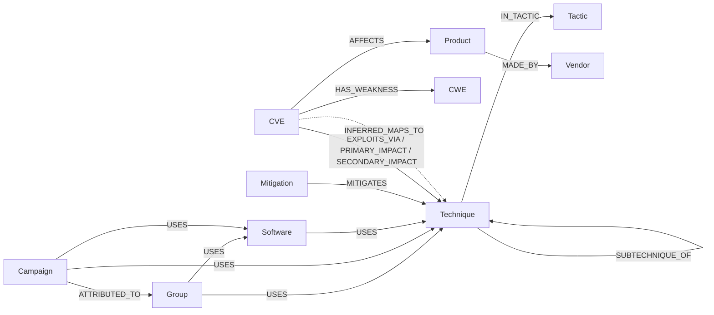

# Modeling rationale

This file records every graph-modeling decision for ThreatGraph: the options considered, their
trade-offs, the choice made and why, and the alternatives that were rejected. It is the reference
for the oral defense.

Each decision starts as **Open**. Where there is one, *Lean* is Claude's suggested option, given
only as a starting point. The decision itself is recorded only once it is made.

## Decision log

| ID  | Decision                                   | Status |
|-----|--------------------------------------------|--------|
| D1  | Node identifiers and uniqueness            | Open   |
| D2  | ATT&CK version, revoked and deprecated objects | Open |
| D3  | Techniques vs sub-techniques               | Open   |
| D4  | Tactics                                    | Open   |
| D5  | Software: malware and tools                | Open   |
| D6  | Scope: campaigns and detection content     | Open   |
| D7  | Properties on ATT&CK relationships         | Open   |
| D8  | CVE severity (CVSS, SSVC)                  | Open   |
| D9  | Weaknesses (CWE)                           | Open   |
| D10 | Vendors and products (KEV, CPE)            | Open   |
| D11 | The CVE ↔ ATT&CK bridge                    | Open   |
| D12 | Verified vs LLM-inferred links             | Open   |

---

## 0. What the data actually looks like

Measured on 2026-10-15 from the live sources, so the trade-offs below rest on real numbers.

**MITRE ATT&CK Enterprise v20** (STIX 2.1 bundle, 55 MB), counting only objects that are neither
revoked nor deprecated:

| STIX type | ATT&CK concept | Live | Revoked/deprecated |
|---|---|---|---|
| `intrusion-set` | Group (G####) | 178 | 15 |
| `campaign` | Campaign (C####) | 57 | 0 |
| `malware` / `tool` | Software (S####) | 747 / 95 | 3 / 0 |
| `attack-pattern` | Technique (T####) | 227 | 143 |
| `attack-pattern` with `x_mitre_is_subtechnique` | Sub-technique (T####.###) | 479 | 18 |
| `x-mitre-tactic` | Tactic (TA####) | 15 | 0 |
| `course-of-action` | Mitigation (M####) | 44 | 224 |
| `x-mitre-detection-strategy` / `x-mitre-analytic` | Detection content | 703 / 1,770 | 2 / 0 |

The relationships between live objects:

| Count | Source → type → target |
|---|---|
| 10,739 | malware `uses` technique |
| 4,815 | group `uses` technique |
| 1,477 | mitigation `mitigates` technique |
| 1,213 | campaign `uses` technique |
| 869 | tool `uses` technique |
| 703 | detection-strategy `detects` technique |
| 691 / 475 | group `uses` malware / tool |
| 479 | sub-technique `subtechnique-of` technique |
| 92 / 81 | campaign `uses` malware / tool |
| 26 | campaign `attributed-to` group |

Other facts that matter:
- A technique's tactics are not STIX relationships. They are listed in each technique's
  `kill_chain_phases`, and 145 of 706 techniques and sub-techniques belong to more than one tactic.
- In v20, the old *Defense Evasion* tactic is gone, split into **Stealth** and
  **Defense Impairment**.
- Each `uses` relationship carries a procedure description, 197 characters on average.
- **No live ATT&CK object references a CVE.** ATT&CK alone never links a group to a CVE.

**CISA KEV** (catalog 2026.10.14):
- 1,745 CVEs, 361 of them with known ransomware use.
- 289 vendors and 734 vendor/product pairs.
- 1,570 CVEs list at least one CWE, 108 list several, and 189 distinct CWEs appear.
- Vendor names are free text, for example `7-Zip`, `ASUS`, `Adobe`.

**NVD API 2.0**, using Log4Shell (CVE-2021-44228) as a worst case:
- CVSS v3.1 comes from two sources (NVD, marked *Primary*, and a CNA, *Secondary*), plus CVSS v2
  and a CISA **SSVC** assessment (`exploitation: active`, `automatable: yes`,
  `technicalImpact: total`).
- The CWEs disagree by source: Apache lists CWE-20, CWE-400 and CWE-502; NVD lists CWE-917.
- **396 CPE match entries covering 166 distinct vendor:product pairs.** 102 of them are version
  ranges, and 23 are marked `vulnerable=false`, meaning they are platform context rather than an
  affected product.
- Without an API key, NVD allows 5 requests per 30 s, so one pass over all of KEV takes about
  3 hours. With a key it takes about 20 minutes.

**CTID Mappings Explorer, KEV → ATT&CK** (latest file `kev-07.28.2025`, built on ATT&CK **16.1**):
- 1,183 mappings of three types: `exploitation_technique` (460), `primary_impact` (407) and
  `secondary_impact` (316).
- **Only 419 CVEs are mapped, 24% of today's KEV.** The 1,326 CVEs added since, or never mapped,
  have no verified ATT&CK link.
- On average 2.8 mappings per mapped CVE, at most 14.
- 155 distinct technique IDs. In v20, 3 of them are revoked or deprecated (6 mappings), and
  techniques mapped under *Defense Evasion* now sit under the split tactics.

**Size.** A full graph is roughly 5–10k nodes and 25–30k relationships, which is small for Neo4j.
Apart from D10, the choices below are about how clear queries are and whether the answers can be
trusted, not about performance.

---

## 1. Questions the graph must answer

The schema exists to answer these questions, so every decision below is judged against them.
They need your confirmation. Add or remove questions before deciding anything.

1. Which techniques does group *X* use, under which tactics, and which mitigations cover them?
2. Which KEV CVEs are used for exploitation technique *T*, and which of those have known
   ransomware use?
3. Which groups use the techniques that CVE *C* enables? This is an *indirect*, path-based
   association, not proof that the group exploited *C* (see D12).
4. Which vendors or products have the most actively exploited CVEs, broken down by weakness
   (CWE)?
5. Which mitigations would cover the most techniques reachable from currently exploited CVEs?
   This is a ranking and graph-algorithm question (GDS).
6. Which techniques are most central in the group–technique graph? This one also uses GDS:
   PageRank, betweenness, community detection.

---

## D1. Node identifiers and uniqueness

Every ATT&CK object has a STIX id (`intrusion-set--bef4c620-…`) and an ATT&CK id (`G0016`). The
STIX id is the stable key that STIX relationships point to. The ATT&CK id is what people, the
CTID mappings and the LLM agent use.

| Option | For | Against |
|---|---|---|
| **A. Key on the STIX id**, store the ATT&CK id as an indexed property | Stable across renames, and relationships join on it directly during import | Agent and API lookups go through a secondary index; ids are unreadable when debugging |
| **B. Key on the ATT&CK id**, keep the STIX id as a property | Readable; matches CTID and how users ask questions | An ATT&CK id can move to another object when one is revoked, so the import must resolve `revoked-by` first |
| **C. Both, each with a uniqueness constraint** | Index-backed lookups either way | Two constraints per label (cheap at this size) |

Non-ATT&CK nodes: CVE → `cve_id`, CWE → `cwe_id`, Product → see D10.

**Cost:** with a uniqueness constraint, a lookup is a B-tree index seek, O(log n); without one it
is a label scan, O(n).

*Lean:* **C**.

## D2. ATT&CK version, revoked and deprecated objects

The CTID mappings use v16.1 and the current release is v20. 3 mapped technique ids are dead in
v20, and the tactics have been restructured.

| Option | For | Against |
|---|---|---|
| **A. Load v16.1** to match the mappings exactly | No mismatch at all | Two years out of date; loses current groups and techniques and the new tactic split |
| **B. Load v20 and remap old ids** through `revoked-by` relationships at import, logging what changed | Current data; every remap is explainable | Some mappings may have no clean successor and need a stated rule (drop or keep as stale) |
| **C. Load v20 and keep revoked/deprecated nodes** flagged `revoked: true`, linked with `REVOKED_BY` | Nothing is lost; old ids still resolve | Every query must filter `WHERE NOT n.revoked`, and forgetting to is an easy bug |

*Lean:* **B**, plus storing `attack_version` on the import metadata so every answer can cite it.

## D3. Techniques vs sub-techniques

| Option | For | Against |
|---|---|---|
| **A. One `:Technique` label** for both, with `(:Technique)-[:SUBTECHNIQUE_OF]->(:Technique)` and an `is_subtechnique` property | Matches STIX; sub-techniques get their own groups, mitigations and CVE mappings | "Roll up to the parent" queries need one extra hop |
| **B. A second label**, `:Technique:SubTechnique`, plus `SUBTECHNIQUE_OF` | Like A, but `MATCH (s:SubTechnique)` is explicit and backed by the label index | Two places say the same thing (the label and the property) |
| **C. Fold sub-techniques into the parent** as a property list | Fewer nodes | Loses data: 479 sub-techniques have their own `uses`, `mitigates` and CTID mappings |

**Cost:** rolling up to the parent adds one hop from each sub-technique to exactly one parent,
so it scales with the number of matched sub-techniques and is negligible.

*Lean:* **B**. C is ruled out by the data.

## D4. Tactics

| Option | For | Against |
|---|---|---|
| **A. `:Tactic` nodes**, `(:Technique)-[:IN_TACTIC]->(:Tactic)`, built from `kill_chain_phases` | Tactics become first-class: kill-chain queries, a tactic-level GDS projection, a place for tactic order and description | 15 extra nodes and about 850 relationships |
| **B. A list property** `tactics: ['execution', …]` on each technique | Simple; one less hop | No index on list members by default; "all techniques in a tactic" scans every technique; the tactic order and description have nowhere to live |

**Cost:** under A, "techniques in tactic X" is an index seek on the tactic, then a walk over its
relationships, O(degree). Under B it is a scan of all 706 techniques, O(n). Tiny either way, but A
is the pattern that scales.

*Lean:* **A**.

## D5. Software: malware and tools

| Option | For | Against |
|---|---|---|
| **A. One `:Software` label** with `type: 'malware' or 'tool'` | One pattern covers "what software does group X use" | Filtering by type means a property check |
| **B. Separate `:Malware` and `:Tool` labels** | Mirrors STIX | Every software question needs `(s:Malware OR s:Tool)` or a UNION |
| **C. Both labels**, `:Software:Malware` and `:Software:Tool` | Query at either level, both index-backed | Slightly more to explain |

*Lean:* **C**.

## D6. Scope: campaigns and detection content

Campaigns (57 of them, with 1,213 technique uses) add dated, concrete activity.
Detection strategies and analytics (2,473 objects) form the new v20 detection model.

| Option | For | Against |
|---|---|---|
| **A. Groups only** | Smallest scope | Loses dated activity (`first_seen`, `last_seen`) and 26 attributions |
| **B. Groups and campaigns**, with `(:Campaign)-[:ATTRIBUTED_TO]->(:Group)` | Enables "recent activity" questions; cheap | One more label |
| **C. B plus detection content** | Covers the "how do I detect it" side | Large, fast-changing, and outside the six questions above |

*Lean:* **B**. Leave detection content out and list it as future work.

## D7. Properties on ATT&CK relationships

Each `uses` relationship carries a procedure description, averaging 197 characters, and external
references (citations).

| Option | For | Against |
|---|---|---|
| **A. Store the description and references on the relationship** | The agent can cite *how* a group uses a technique, which supports the "cited answer" requirement | About 3 MB of text on relationships; properties on relationships are not indexed by default |
| **B. Keep only the STIX id** of the relationship and fetch the text from the source file when needed | Lean graph | The agent cannot cite from the graph alone |

*Lean:* **A**, plus a `source: 'attack'` property on every relationship (it ties into D12).

## D8. CVE severity: CVSS and SSVC

| Option | For | Against |
|---|---|---|
| **A. Flat properties** on `:CVE`: `cvss_score`, `cvss_severity`, `cvss_vector`, `cvss_version`, taken from the NVD *Primary* metric (v4.0 if present, else v3.1), plus the SSVC fields | Direct filtering and sorting (`ORDER BY c.cvss_score`); a range index on the score | Secondary and CNA scores are dropped |
| **B. `:CVSSMetric` nodes**, one per (version, source) | Keeps every score; shows where sources disagree | Every severity question needs an extra hop and a rule for choosing among sources |

*Lean:* **A**. Record the rule for choosing the metric in this file.

## D9. Weaknesses (CWE)

| Option | For | Against |
|---|---|---|
| **A. `:CWE` nodes**, `(:CVE)-[:HAS_WEAKNESS {source}]->(:CWE)` | Question 4 becomes a cheap aggregation; CWEs that are shared form graph structure useful for GDS | 189 nodes; the KEV and NVD CWE lists need merging, with `source` recording which list each came from |
| **B. A list property** `cwes: [...]` on `:CVE` | Simple | Counting by weakness means unwinding every CVE's list, O(n) |

*Lean:* **A**.

## D10. Vendors and products (KEV, CPE)

This is the one decision that changes the graph's size. Log4Shell alone has 396 CPE matches
covering 166 products, many of them version ranges.

| Option | For | Against |
|---|---|---|
| **A. KEV vendor/product only**, `(:CVE)-[:AFFECTS]->(:Product)-[:MADE_BY]->(:Vendor)` | 289 vendors and 734 products; one source; no NVD dependency for this part | Free-text names; coarse (one product per CVE) |
| **B. NVD CPE at vendor:product level**, with version ranges as properties on `AFFECTS`, `vulnerable=false` matches skipped | Accurate, normalized names; captures that Log4Shell affects 166 products | A few thousand Product nodes; one NVD call per CVE; KEV names must be matched to CPE names |
| **C. One node per CPE version** | Finest grain | Not feasible: version *ranges* do not list versions, so the nodes would be invented; a large blow-up |

**Cost:** under B, "products affected by CVE C" walks C's relationships, O(degree), with degree up
to about 170. "CVEs affecting product P" is an index seek on P plus its relationships.

*Lean:* **B**, with KEV's `vendorProject`/`product` kept as properties on `:CVE` as a fallback.

## D11. The CVE ↔ ATT&CK bridge

CTID provides 1,183 mappings with a `mapping_type` and the free-text fields `comments` and
`references`.

| Option | For | Against |
|---|---|---|
| **A. One relationship type** `(:CVE)-[:MAPS_TO {mapping_type, source, attack_version}]->(:Technique)` | One pattern to query; filter on the type when needed | Filtering by mapping type is a property check on the relationship |
| **B. One relationship type per mapping type**: `EXPLOITS_VIA`, `PRIMARY_IMPACT`, `SECONDARY_IMPACT` | The meaning is in the schema; the relationship-type index makes filtering free; the diagrams read well | Three patterns, or a type alternation, for "any link" |
| **C. A `:Mapping` node** in the middle, `(:CVE)-[:SUBJECT_OF]->(:Mapping)-[:MAPS_TO]->(:Technique)` | Holds provenance, comments and references cleanly; can be extended for LLM links | Two hops for every bridge query, which also makes every GDS projection over the bridge harder |

*Lean:* **B**, with provenance properties (`source`, `attack_version`, `mapping_date`) on each
relationship.

## D12. Verified vs LLM-inferred links

76% of KEV CVEs have no CTID mapping, and ATT&CK never links groups to CVEs. The agent will be
tempted to fill these gaps, and the brief requires keeping verified facts apart from inferred
ones.

| Option | For | Against |
|---|---|---|
| **A. The same relationship types** as D11, with `source: 'llm'`, `confidence`, `model` and `created_at` | One schema | A missing `WHERE r.source <> 'llm'` silently mixes inferred links into verified answers |
| **B. Separate relationship types**, such as `INFERRED_MAPS_TO {confidence, model, rationale}` | Verified-only queries cannot pick up inferred links by accident; the guardrail is structural | Questions over "verified or inferred" need both types |
| **C. Never store inferred links**, only compute them at answer time | The graph stays 100% sourced | Not reproducible; the inference is redone on every question |

**Question 3 (group ↔ CVE):** answer it only as a path,
`(g:Group)-[:USES]->(t:Technique)<-[:EXPLOITS_VIA]-(c:CVE)`, reported as "shares technique T",
never as "group G exploits CVE C".

*Lean:* **B**.

---

## Draft schema (Claude's leans only, nothing decided)

---

## Rejected alternatives

*(Filled in as decisions are made: the option, why it was rejected, and the date.)*
